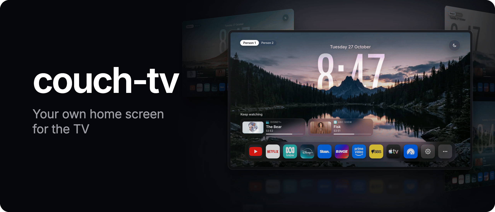
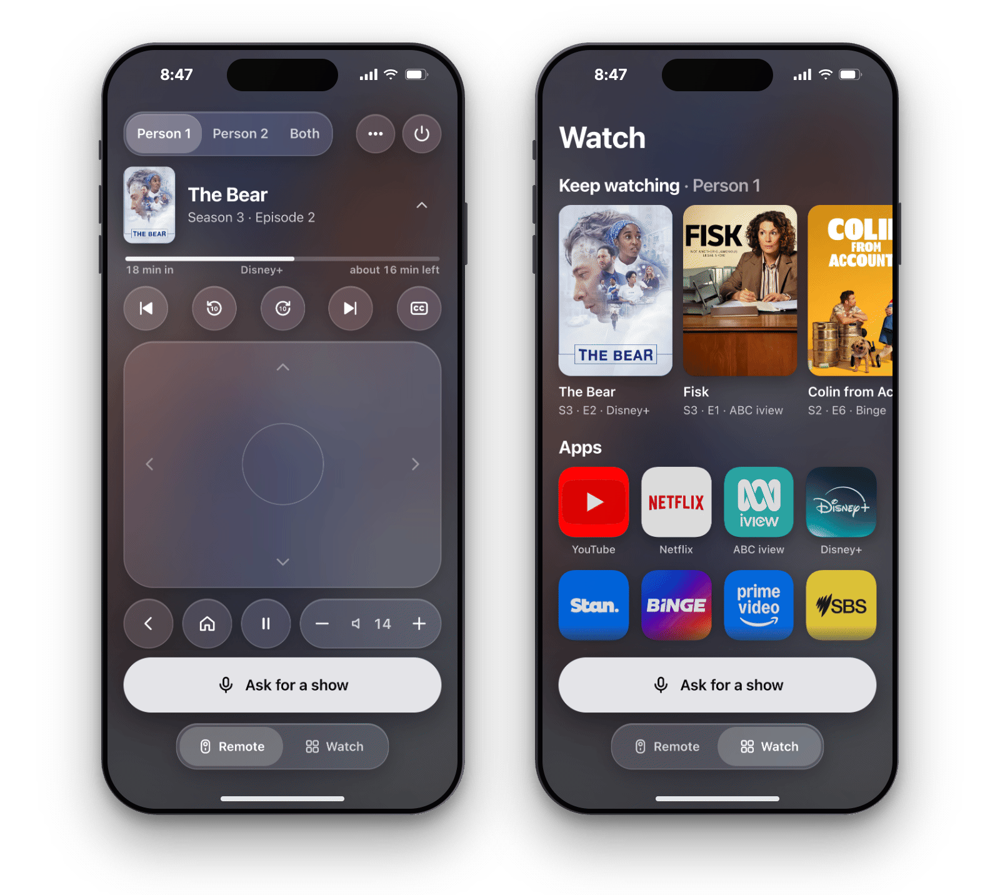
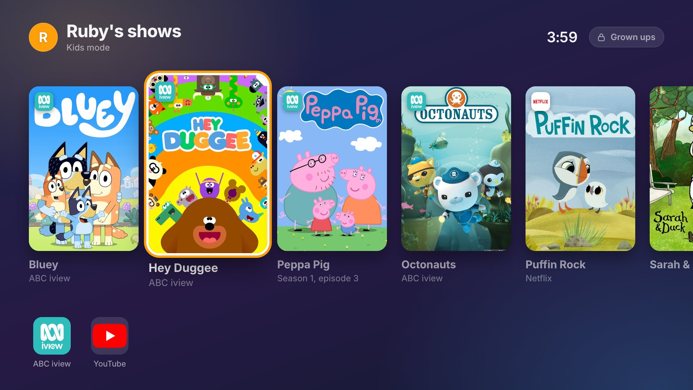
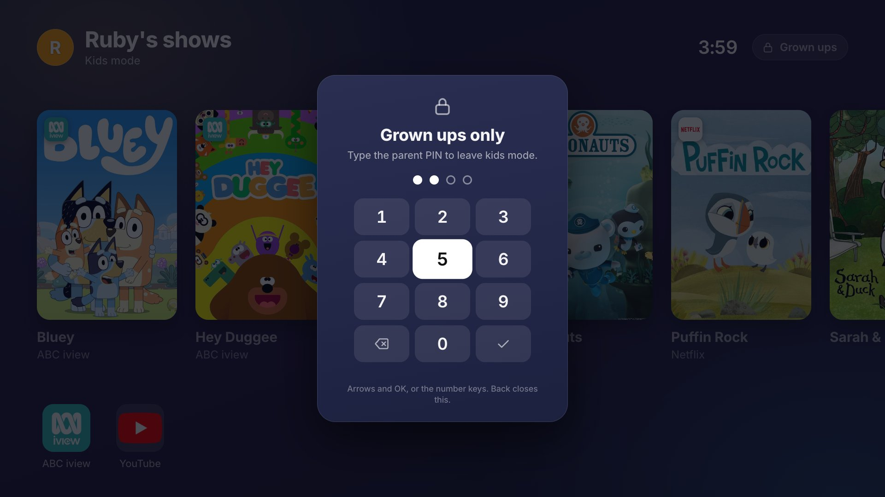
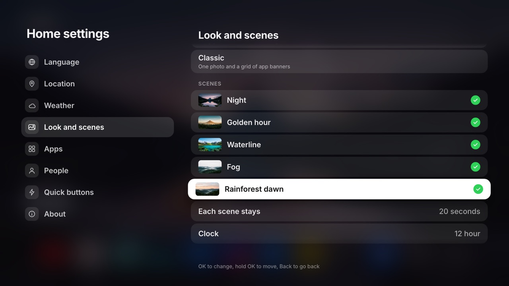
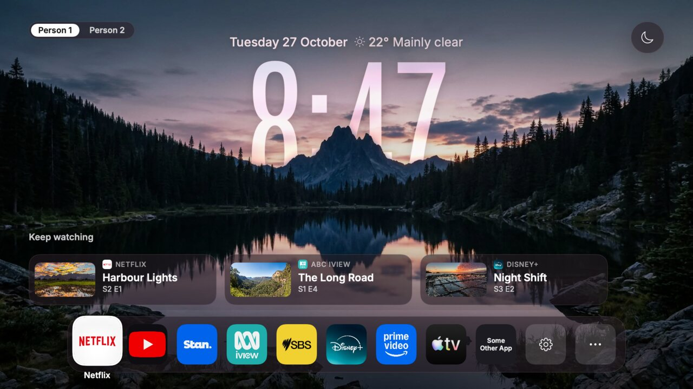
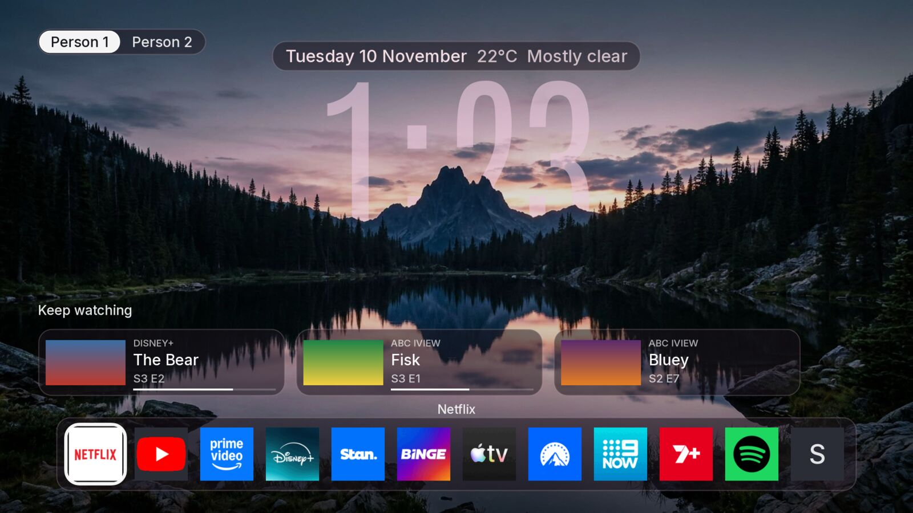
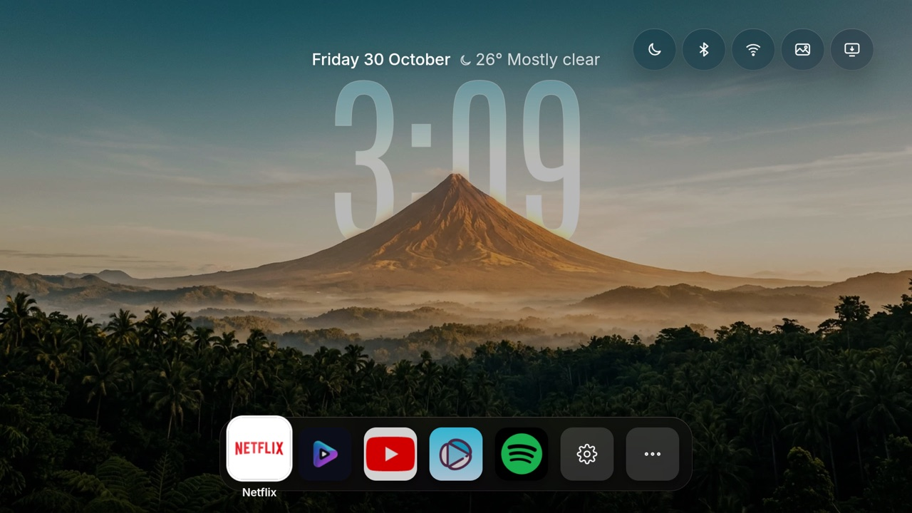

<p align="center"></p>

<p align="center">
  <b>Your own home screen and phone remote for the TV.</b><br>
  Scenes with a glass clock, your apps in your order, Keep watching across apps,
  and a phone remote that finds a show and starts it. No ads on the home screen. Open source.
</p>

<p align="center">
  <a href="https://github.com/Seagey/couch-tv/releases/latest"></a>
  <a href="LICENSE"></a>
  <a href="#will-it-work-on-my-tv"></a>
</p>

<p align="center"><b>
  <a href="#get-started">Set it up</a>
  &nbsp;·&nbsp; <a href="#will-it-work-on-my-tv">Which TVs</a>
  &nbsp;·&nbsp; <a href="docs/README.md">Docs</a>
  &nbsp;·&nbsp; <a href="docs/UPDATES.md">What's new</a>
</b></p>

## Get started

1. **With your AI agent, the easiest way.** Open this folder in Claude Code (or any coding agent)
   and say "set this up on my TV". It reads [AGENTS.md](AGENTS.md), finds your TV, asks which option
   you want and a few questions (who watches, the look, your apps), reads the plan back, and changes
   nothing on the TV until you say yes.
2. **From your phone or a computer:** [couchtv.sites.underseage.studio](https://couchtv.sites.underseage.studio),
   with the free Setup app on a Mac or Windows computer. It also checks whether your TV will work.
3. **By hand:** [docs/SETUP.md](docs/SETUP.md) has every step, from developer mode to the TV home,
   and how to [undo it](docs/SETUP.md#undo-put-the-google-home-screen-back).

**Pick the way for your TV before you start.** Not every way does the whole job on every TV:

| Way | What you need | Google TV | Android TV | Fire TV | Samsung or LG |
|---|---|---|---|---|---|
| **AI agent** ([AGENTS.md](AGENTS.md)) | A computer on the TV's Wi-Fi with Claude Code or another coding agent | Yes, Home button included | Yes | Yes, Home button included (Amazon's home flashes up first). The full phone remote keeps a computer on at home | Yes, as an app that a computer at home that stays on opens. Their own Home button still opens their own menu |
| **From your phone** ([website](https://couchtv.sites.underseage.studio/phone)) | The TV remote and a phone on the same Wi-Fi. No computer | Only part: the app and the phone remote, but Google keeps the Home button. AI or the Setup app adds the Home button once, even afterwards | Yes. On Android TV 10 and newer the app asks Android to make it the home | Only part: Home needs three one off grants from a computer, and on current Fire OS the phone remote can't press keys or type | No |
| **Setup app** ([website](https://couchtv.sites.underseage.studio/computer)) | A Mac or Windows computer on the same Wi-Fi, once | Yes, Home button included | Yes, Android TV 7.1 and newer | Yes on Fire OS 6, 7 and 8 (Amazon's home flashes up first) | No |
| **By hand** ([docs/SETUP.md](docs/SETUP.md)) | A Mac or Linux computer with Python 3.11 or newer | Yes | Yes | [on-tv/README.md, Fire TV](on-tv/README.md#fire-tv-fire-os) | [docs/SAMSUNG.md](docs/SAMSUNG.md), [docs/LG.md](docs/LG.md), with a computer at home that stays on |

Other TVs: [Will it work on my TV?](#will-it-work-on-my-tv)

> [!NOTE]
> Set couch-tv up with 0.10 or older on a Google TV? 0.11 and newer leave the Google home and setup
> apps switched on. Read [If your TV loops after a restart](docs/TROUBLESHOOTING.md#if-your-tv-loops-after-a-restart)
> before you next restart your TV.

<a name="setup"></a><a name="setting-it-up-with-an-ai-agent"></a><a name="what-you-need"></a><a name="step-1-developer-mode-on-the-tv-every-option"></a><a name="step-2-get-the-code-and-set-up-python-every-option"></a><a name="step-3-pair-the-tv-with-the-bridge-option-b"></a><a name="step-4-build-the-phone-remote-option-b"></a><a name="step-5-run-the-bridge-option-b"></a><a name="step-6-put-the-tv-home-on-the-tv-options-a-and-b-it-becomes-the-home-the-google-home-stays-on"></a><a name="building-the-app-instead-of-downloading-it"></a><a name="undo-put-the-google-home-screen-back"></a><a name="if-your-tv-loops-after-a-restart"></a><a name="troubleshooting"></a><a name="tcl-home-goes-back-to-google-tv-after-every-restart"></a><a name="if-disney-or-another-app-signs-you-out-after-the-tv-turns-off"></a><a name="seeing-every-app"></a>

## Updates

The newest release is **0.13.8**, on [the Releases page](https://github.com/Seagey/couch-tv/releases): Home settings pages such as Update couch-tv open at the top, and Up reaches the lines above the first button ([details](docs/UPDATES.md#20-november-2026-release-0138-home-settings-pages-open-at-the-top)). 0.13.7 made sure Hold OK never opens the app on a TCL either, the arrow that points at the Settings gear reaches it, and on a Samsung Home settings, About shows the version and how to update, while a Frame opens couch-tv more reliably after Art Mode ([details](docs/UPDATES.md#20-november-2026-release-0137-hold-ok-on-a-tcl-the-gear-by-arrow-and-samsung-updates)). 0.13.6 brought update news on the TV (Home settings, About, Update couch-tv, now on the on-TV app too), a Settings gear that never covers a widget, and a Hold OK that never opens the app ([details](docs/UPDATES.md#19-november-2026-release-0136-the-tv-tells-you-about-updates-and-the-settings-gear-stays-clear)). 0.13.5 brought fixes from a real beginner on a TCL (Use as home screen asks properly and Cancel means no, the TV says plainly when Google keeps the Home button, and design codes are easy to type with the remote) ([details](docs/UPDATES.md#19-november-2026-release-0135-fixes-from-a-real-beginner-on-a-tcl)). 0.13.4 brought Samsung, with couch-tv Studio, a setup you run yourself with no AI agent (`couch-tv-samsung-setup.zip`), and a Frame that opens couch-tv after Art Mode and goes to Art Mode when the phone says off; plus couch-tv Studio designs in the Apple TV app ([details](docs/UPDATES.md#19-november-2026-release-0134-samsung-with-couch-tv-studio-and-a-setup-that-needs-no-ai-agent)). 0.13.3 made it easier for beginners (a Settings button on every design, a phone only install that no longer asks for the accessibility permission Play Protect flags, plain words on the TV and in the Setup app), greeted guests by name with no computer, and brought your home into couch-tv Studio. 0.13.2 brought Ask AI, your own AI agent, smart home set up on the TV and designs on Roku. New in 0.13:

- **14 November:** custom cards with a web link open in the TV's browser on Android TV, LG and Samsung, thanks ekagra-codes ([#207](docs/UPDATES.md#14-november-2026-custom-cards-with-a-web-link-open-on-android-tv-lg-and-samsung-since-013))
- **14 November:** choose where the home starts: profiles (as before), Keep watching or apps, thanks nidhalmouldi and ekagra-codes ([#211](docs/UPDATES.md#14-november-2026-choose-where-the-home-starts-profiles-keep-watching-or-apps-since-013))

- **15 November:** the clock follows the TV's 12 or 24 hour setting, and Keep watching stays in view while you remove a show, thanks devmaliakbar and Hiren-Patel1 ([#221, #218](docs/UPDATES.md#15-november-2026-the-clock-follows-the-tvs-12-or-24-hour-setting-and-keep-watching-stays-in-view-while-you-remove-a-show-since-013))
- **14 November:** Restart home in Home settings, About, thanks janooh37-hue ([#217](docs/UPDATES.md#14-november-2026-restart-home-in-home-settings-about-since-013))
- **14 November:** two more real LGs (a NANO80TNA app only, a 28TQ515S with the bridge in Docker on a Synology), and `--apps tv` pairs by itself, thanks Anshul7171 and adri07 ([#219](docs/UPDATES.md#14-november-2026-two-more-real-lgs-and---apps-tv-pairs-by-itself-since-013), #220)
- **14 November:** on a VIZIO, couch-tv's home in the TV's own webview, tried on one set, thanks lukionsp ([#206](docs/UPDATES.md#14-november-2026-vizio-couch-tvs-home-in-the-tvs-own-webview-beta-since-013))
- **14 November:** input tiles for each TV, and a picture on an input tile, thanks BireshwarChakravarty ([#205](docs/UPDATES.md#14-november-2026-input-tiles-for-each-tv-and-a-picture-on-an-input-tile-since-013))
- **14 November:** an LG goes back to couch-tv in about half a second, and input tiles switch straight to HDMI, thanks BireshwarChakravarty ([#204](docs/UPDATES.md#14-november-2026-lg-goes-back-to-couch-tv-in-about-half-a-second-and-input-tiles-switch-straight-to-hdmi-since-013))
- **14 November:** remove a card from Keep watching on the phone remote, and it returns when you play the show again, thanks poinch ([#176](docs/UPDATES.md#14-november-2026-remove-a-card-from-keep-watching-on-the-phone-remote-since-013))
- **14 November:** your own cards on the home from a small JSON file, display only, thanks geissmannz on Instagram for the idea ([custom cards](docs/UPDATES.md#14-november-2026-your-own-cards-on-the-home-without-changing-couch-tv-since-013))
- **14 November:** the bridge's messages in Polish, and the assistant answers in the home's language, thanks Azumi0 ([#196](docs/UPDATES.md#14-november-2026-polish-bridge-messages-and-the-assistant-answers-in-polish-since-013))
- **14 November:** a TV settings quick button, and Settings opens on its own screen, thanks syedhabibtirmizi ([#190](docs/UPDATES.md#14-november-2026-a-tv-settings-quick-button-and-settings-opens-on-its-own-screen-since-013))
- **14 November:** the TV home installs over paired Wireless debugging, tested on an Epson LS300, thanks mazzanfar ([#194](docs/UPDATES.md#14-november-2026-tv-home-over-paired-wireless-debugging-tested-on-an-epson-ls300-since-013))
- **14 November:** the Look button and Home settings changes show at once on the TV home, thanks clembgrn and syedhabibtirmizi ([#185](docs/UPDATES.md#14-november-2026-the-look-button-and-home-settings-changes-show-at-once-on-the-tv-home-since-013))
- **14 November:** the phone remote is complete in Brazilian Portuguese, thanks scursel ([#195](docs/UPDATES.md#14-november-2026-the-phone-remote-is-complete-in-brazilian-portuguese-since-013))
- **14 November:** Czech is complete on the TV home and the phone remote speaks Czech, thanks slezaCZ ([#180](docs/UPDATES.md#14-november-2026-czech-is-complete-and-the-phone-remote-speaks-czech-too-since-013))
- **14 November:** `home.hi_res: "always"` loads the sharper 4K scenes on a 4K TV that draws its interface at 1080, thanks Hiren-Patel1 ([#191](docs/UPDATES.md#14-november-2026-sharper-scenes-on-a-4k-tv-that-draws-its-interface-at-1080-since-013))
- **14 November:** an app banner that is not 16:9 keeps its proportions instead of being squeezed, thanks niravsaxena30 ([#181](docs/UPDATES.md#14-november-2026-an-app-banner-that-is-not-169-is-no-longer-squeezed-since-013))
- **13 November:** the TV home speaks Czech, thanks slezaCZ ([#178](docs/UPDATES.md#13-november-2026-czech-on-the-tv-home-since-013))
- **13 November:** Bell Streamer's Fibe TV home is replaced by couch-tv, thanks Sparkybabcia ([#168](docs/UPDATES.md#13-november-2026-bell-streamer-with-fibe-tv-as-its-home-beta-since-013))
- **13 November:** Privacy clean: `PRIVACY=1` switches off known tracking, ad and ACR apps, reversibly ([docs/PRIVACY.md](docs/PRIVACY.md), [details](docs/UPDATES.md#13-november-2026-privacy-clean-beta-on-main))
- **13 November:** the home comes back to the tile you left after Settings, thanks IshMehta ([#166](docs/UPDATES.md#13-november-2026-the-home-comes-back-to-the-tile-you-left-since-013))
- **13 November:** on Fire OS 7 Couch TV comes back without the 5 second wait, thanks atul016 ([#162](docs/UPDATES.md#13-november-2026-fire-os-7-brings-couch-tv-back-without-the-5-second-wait-since-013))
- **13 November:** the Next song button skips the track again on a Mi Box, thanks NathanGlasby ([#158](docs/UPDATES.md#13-november-2026-the-next-song-button-skips-the-track-again-since-013))
- **14 November:** Brazilian Portuguese on the TV home and the phone remote, thanks scursel ([#193](docs/UPDATES.md#14-november-2026-brazilian-portuguese-on-the-tv-home-and-the-phone-remote-since-013))
- **14 November:** Polish on the TV home and the phone remote, thanks Azumi0 ([#184](docs/UPDATES.md#14-november-2026-polish-on-the-tv-home-and-the-phone-remote-since-013))
- **13 November:** the TV home speaks Hebrew, right to left, thanks YuvalHir ([#153](docs/UPDATES.md#13-november-2026-hebrew-and-right-to-left-layout-on-the-tv-home-since-013))

Every change, with credits: [docs/UPDATES.md](docs/UPDATES.md).

## Three ways to run it

- **A. TV home only.** The new home screen, and you use your normal TV remote. No computer has to
  stay on. Set up with [docs/SETUP.md](docs/SETUP.md), steps 1, 2 and 6.
- **B. Computer bridge.** The home, the phone remote, "put on Bluey", turning the TV on from the
  phone, Keep watching across apps and the optional assistant. A Mac, a Linux box or a Raspberry Pi
  at home stays on and runs the bridge. Set up with [docs/SETUP.md](docs/SETUP.md), steps 1 to 6.
- **C. Lives on the TV.** The home and the phone remote with no computer: the bridge runs inside an
  app on the TV. Set up with [on-tv/README.md](on-tv/README.md).

## Will it work on my TV?

A is the TV home only, B adds the computer bridge, C lives on the TV ([the three ways](#three-ways-to-run-it)).

| Your TV | A | B | C |
|---|---|---|---|
| [Google TV](docs/PLATFORMS.md#google-tv-and-android-tv) | Yes | Yes | Partial |
| [Google TV box](docs/PLATFORMS.md#google-tv-and-android-tv) | Yes | Yes | Partial |
| [Older Android TV](docs/PLATFORMS.md#google-tv-and-android-tv) | Yes | Yes | Yes |
| [Android 6 TV](docs/PLATFORMS.md#all-tvs-in-one-table) | Works with 0.13 or later | Not reported | Works with 0.13 or later |
| [XGIMI projector](docs/PLATFORMS.md#all-tvs-in-one-table) | Yes | Not reported | Yes |
| [Nvidia Shield](docs/PLATFORMS.md#google-tv-and-android-tv) | Yes | Yes | Yes |
| [Fire TV on Fire OS](docs/PLATFORMS.md#fire-tv-on-fire-os) | Partial | Partial | Partial |
| [Fire TV on Vega OS](docs/PLATFORMS.md#fire-tv-on-vega-os) | App only | With a computer at home | No |
| [Samsung](docs/PLATFORMS.md#samsung) | App only | As an app | No |
| [LG](docs/PLATFORMS.md#lg) | App only | As an app | No |
| [Roku](docs/PLATFORMS.md#roku) | App only | As a channel | No |
| [Hisense VIDAA](docs/PLATFORMS.md#hisense-vidaa) | App only | With a computer at home | No |
| [Philips with Titan OS](docs/PLATFORMS.md#philips-with-titan-os) | Not yet | Remote only, with a computer at home | No |
| [Older Philips with Saphi](docs/PLATFORMS.md#older-philips-with-saphi) | No | With a computer at home | No |
| [VIZIO](docs/PLATFORMS.md#vizio) | No | Remote, with a computer at home (home in the TV's webview by hand, one set) | No |
| [Panasonic Viera](docs/PLATFORMS.md#panasonic-viera) | No | With a computer at home | No |
| [Apple TV](docs/PLATFORMS.md#apple-tv) | No | With a computer at home | No |
| [TiVo OS](docs/PLATFORMS.md#tivo-os) | No | With a computer at home | No |

**With a computer at home** means a computer at home that stays on, and the maker's own Home button still opens the maker's own home.

**It depends on the model, not the brand.** Open **Settings, System, About** (or **Device Preferences, About**) on the TV: "Android TV OS" means yes ([brand by brand](docs/TV-BRANDS.md)).

**Want everything on a TV that is not Google TV or Android TV?** Plug in a Google TV box (for example the Google TV Streamer) and set couch-tv up on that, and you get everything, on any TV with an HDMI port.

**Test your own TV** (changes nothing on it, and installs nothing outside this folder):

```sh
git clone https://github.com/Seagey/couch-tv.git && cd couch-tv
python3 --version                                  # needs 3.11 or newer
python3 -m venv .venv && .venv/bin/pip install -r bridge/requirements.txt
.venv/bin/python scripts/find-tvs.py               # lists the TVs on your Wi-Fi
.venv/bin/python scripts/check-tv.py <tv address>  # says which options that TV can run
```

It knocks on the ports each kind of TV answers on, so it can tell a Samsung from a Google TV without touching anything. More, including the check by hand and `--adb`: [docs/PLATFORMS.md](docs/PLATFORMS.md#test-your-own-tv).

## Home backgrounds

Five scenes take turns every 20 seconds, each with a big glass clock that sits just behind the
scenery: the peaks, the volcano and the misty hills overlap the digits, and on the lake the clock
floats with its reflection under the water. Or pick the Classic look, your own photos, or
[a scene you design yourself](docs/MAKE-A-SCENE.md).

## The easy way: couch-tv Setup

A free app for Mac and Windows that puts couch-tv's home screen on a **Google TV, Android TV or
Fire TV** with no command line and no AI agent. It opens a page in your browser and walks you
through it: Developer options with the TV remote, a 6 digit code (Google TV on Android 12 or newer)
or one Allow press (Android TV, and Google TV on Android 11), then it installs couch-tv from this
repo's Releases, checks it, sets it up the way `apply.sh` does (option A), and can add the phone
remote. It shows the plan and waits for your yes before it changes anything, and it can undo all of
it. Download it from [the Releases page](https://github.com/Seagey/couch-tv/releases) (the Mac zip
and the Windows zip); how to open it the first time: [setup-app/README.md](setup-app/README.md).

If the TV never shows "Allow USB debugging?", the app walks you through the fixes one at a time,
and if the TV still says no, it shows how to put couch-tv on with just your phone instead.

**Other TVs, not through this app** (each has its own way, most with a computer at home that stays on):

| TV system | How |
|---|---|
| **Samsung (Tizen)** | `couch-tv-samsung-setup.zip` from [the Releases page](https://github.com/Seagey/couch-tv/releases): double-click its installer on a Mac or Windows computer, no AI agent needed ([docs/SAMSUNG.md](docs/SAMSUNG.md#the-quick-way-no-ai-agent-no-paid-plan)) |
| **LG (webOS)** | [docs/LG.md](docs/LG.md) |
| **Roku OS** (Roku TVs and sticks) | [docs/ROKU.md](docs/ROKU.md) |
| **VIDAA** (Hisense's own system) | [docs/VIDAA.md](docs/VIDAA.md) |
| **Apple TV (tvOS)** | [docs/APPLE-TV.md](docs/APPLE-TV.md) |
| **Fire TV on Vega OS** (Fire TV Stick 4K Select, Fire TV Stick HD 2026, Fire TV Stick 4K 3rd gen) | [docs/FIRE-VEGA.md](docs/FIRE-VEGA.md) |
| **Panasonic with My Home Screen** | [docs/PANASONIC.md](docs/PANASONIC.md) (Panasonic's Fire TV and Google TV models work with this app) |
| **TiVo OS** on any brand | [docs/TIVO.md](docs/TIVO.md) |
| **Philips with Titan OS or Saphi** | [docs/PHILIPS-TITAN.md](docs/PHILIPS-TITAN.md), [docs/PHILIPS-SAPHI.md](docs/PHILIPS-SAPHI.md) (Philips Google TV and Android TV models work with this app) |

A Google TV box (for example the Google TV Streamer) plugged into any of these gets everything.
Android 6 and 7.0 TVs (for example the Xiaomi Mi TV 4A with PatchWall) are set up from a computer
with the steps below; the app says so before it changes anything.

The Fire TV setup builds on couch-tv-setup by killy10o10.

### Community tools

Made by people outside this repo, not checked by us after the version named:
- [couch-tv-setup](https://github.com/killy10o10/couch-tv-setup) by killy10o10: a setup app for
  couch-tv's "lives on the TV" app on Fire TV sticks, with an optional switch off for Amazon's
  advert and tracking apps (we reviewed v0.1.2: [setup-app/REVIEW-killy10o10.md](setup-app/REVIEW-killy10o10.md)).

## Setting it up with an AI agent

<p align="center">
  
  
  
  
  
  
</p>

<p align="center"><sub>Night, Golden hour, Waterline, Fog, Dawn and Classic. Shown with sample shows and sample people.</sub></p>

## The phone remote

Your phone becomes the remote: arrows, volume, typing and the power button. Ask for a show by name
("put on Bluey") and couch-tv finds where it streams and starts it in the right app, past "Who's
watching?" on Android TV. There is an optional assistant for "put on something funny": Claude with the
bridge, or Claude and other AI services in on-TV mode. Needs [option B or C](#three-ways-to-run-it).

<p align="center"></p>

<p align="center"><sub><a href="docs/REMOTE.md">The phone remote</a> · <a href="docs/REMOTES.md">TV remotes and keys</a> · <a href="docs/ASK-PROVIDERS.md">Ask with any AI service</a></sub></p>

## Kids mode

A kids profile's home is one shelf of shows you chose, as big posters that open straight into each
show, plus only the apps you allow. No other apps, no settings, no grown ups' Keep watching. Leaving
it needs the parent PIN. Optional, and off unless you set it up.

<p align="center">
  
  
</p>

<p align="center"><sub><a href="docs/TV-HOME.md#kids-mode">How Kids mode works and what it cannot do</a> · <a href="docs/CONFIG.md#kids-mode">Every setting</a></sub></p>

## Settings on the TV

No computer and no `config.json` needed for the everyday settings. Pick the gear in the dock, or
press the remote's own Settings button, and change the language, the place for the weather, the
look and scenes, your apps and their order, the people and the quick buttons, with any remote.

<p align="center"></p>

<p align="center"><sub><a href="docs/TV-HOME.md#home-settings">Every Home setting in full</a></sub></p>

## And a lot more

- **[Keep watching](docs/TV-HOME.md#scenes-and-looks)**: up to 10 shows you were part way through, newest first, per person with options B and C.
- **[Now playing](docs/TV-HOME.md#now-playing)**: the song, the artist and its cover while music plays, with play, pause and skip.
- **[Glass and video](docs/TV-HOME.md#glass-and-video)**: clear glass panels and icons, a liquid glass clock, or a looping video behind it all.
- **[Quick buttons](docs/TV-HOME.md#quick-buttons)**: sleep timer, picture mode, inputs by name, screensaver and more, one press from the home.
- **[Smart home](docs/TV-HOME.md#smart-home)**: air conditioning, scenes and a doorbell card from Home Assistant. Off unless you add it.
- **[Sixteen languages](docs/TV-HOME.md#languages)**: English, Spanish, Mexican Spanish, Italian, German, French, Turkish, Serbian, Polish, Dutch, Hebrew, Czech, Brazilian Portuguese, Arabic, Romanian and Simplified Chinese.
- **[Your own photos](docs/TV-HOME.md#your-own-photos)**: from a USB drive, the TV or the web, taking turns with the scenes.
- **[Two TVs, one show](docs/SYNC.md)**: start the same show on two TVs at once, so two rooms do not echo.
- **[Move to another TV](docs/MOVE.md)**: carry on in another room. One tap on the phone pauses the show here and starts it there, as the same person. New, Android and Google TV with the bridge.
- **[Updates on the TV](docs/TV-HOME.md#updates)**: off until you say yes. Then the TV tells you about a new version and hands it to Android to install.

## couch-tv Studio (optional)

[couch-tv Studio](https://tvdesigner.sites.underseage.studio) is a website for designing your TV
home: place the clock, the dock and widgets where you like, then send the design to your TV with a
short code. It also has a gallery of designs other people made.

- **couch-tv stays free and open source** (MIT). Studio is an optional hosted service, run
  separately, and its source is not open. You never need it to use couch-tv.
- **Off until you turn it on.** Installing or updating couch-tv never switches it on. Until someone
  at the TV turns it on (Home settings, couch-tv Studio) or types a code there, the TV asks Studio
  for nothing. **Back to my classic home** switches it off again in one step.
- **What the TV sends to Studio:** the code you typed, with no cookies and no referrer. While a
  design is on, the TV also fetches the fonts the design names from Studio, and the design's
  background video, if it has one, by the video's id and a size (720p or 1080p, short clip or long
  loop), with no cookies and no referrer; once it has played, the TV keeps its own copy and does
  not ask again. While a news,
  scores, markets or commute widget is on, it asks Studio once a day whether that source is paused.
  **Open this home in couch-tv Studio** (called Share this home on 0.13.0 to 0.13.2) sends the
  layout of the home you have now, without names, photos, places, keys or calendar links.
- **Bring the home you have now into Studio.** On the TV: Home settings, couch-tv Studio, **Open this
  home in couch-tv Studio**. The TV shows a QR code and a 10 letter code; scan it, or type the code
  under "Already use couch-tv from GitHub?" on Studio's start screen. It opens as a design you can change, keep
  in My designs and send back. Only the look (scenes, clock, glass, the dock's style and size,
  Keep watching and Now playing on or off) and the dock's apps go, in order. A TV older than 0.13
  cannot do this: on the computer that set it up, open Studio, press **Open my config.json** and
  pick the `config.json` in your couch-tv folder. It brings the look from `home`; your people,
  weather place, bridge, Home Assistant and Plex sections are left out on purpose. Never pick `.env`:
  it only holds keys, and Studio does not need it. Step by step, with pictures: Studio's help,
  "Bring your couch-tv home into Studio".
- **What never leaves the TV:** your watch history, your people, things typed at home (the note,
  lists, the guest Wi-Fi password, the house guide, a calendar address) and a Home Assistant token.
  A design or a share refuses anything that looks like a token or a private key.
- **What it costs:** making a design and the starter designs are free. Some gallery designs cost a
  little. The gallery takes a flat 20% of a sale, and the person who made the design keeps 80%,
  less the card payment fee.
- Every setting a design can carry, and the checks the TV makes on it: [docs/CONFIG.md, Design](docs/CONFIG.md#design-design-from-couch-tv-studio).

## One home, many TVs

The same home on Google TV and Android TV, an app on Apple TV, a channel on Roku, and Fire TV,
Samsung and LG versions, with more paths for other TVs.

<p align="center">
  
  
  
</p>

<p align="center"><sub>Apple TV, Roku and a Fire TV Stick.</sub></p>

## Android permissions, and why

Every permission the Android apps ask for, read from their manifests. Several strong ones are not
granted when you install: they are granted over ADB, after you allowed that computer or app at the
TV, and only for the feature that needs them. `tests/test_docs_permissions.py` fails if a manifest
gains a permission these tables do not explain.

**The TV home** (`tv-home/`, the app called Home, options A and B):

| Permission | Granted | Why |
|---|---|---|
| `INTERNET` | On install | The home's own page: your bridge on the home network (option B), the weather, posters, the update check and the widgets you add |
| `ACCESS_NETWORK_STATE` | On install | To tell whether the TV is online before it asks for anything |
| `READ_TV_LISTINGS` | By `apply.sh` | Keep watching: reads Android's Watch Next list (what each app says you are part way through). Read only |
| `PACKAGE_USAGE_STATS` | Only with `SCREEN_TIME=1`, or when you switch Home on in the TV's Usage access screen | The Screen time widget: today's time in each app. Off unless you ask for it |
| `SYSTEM_ALERT_WINDOW` | By `apply.sh`, only when `config.json` has a doorbell | The doorbell card over whatever is playing. A later `apply.sh` run without a doorbell takes it back |
| `BLUETOOTH_CONNECT` | Android 12 and newer: only when you press OK on a Batteries widget and pick Allow on Android's question | The Batteries widget: the charge left in remotes and controllers paired with the TV. Only their names and levels, kept on the TV |
| `BLUETOOTH` | On install, Android 11 and older only | The same Batteries widget, on older Android: lists the paired remotes and controllers |
| `REQUEST_INSTALL_PACKAGES` | Android asks you once | Updates: hands a new release to Android's installer, which always asks the person at the TV first |
| `REQUEST_DELETE_PACKAGES` | On install | Hold OK on an app, Uninstall: opens Android's own remove dialog, which always asks first |
| `WRITE_SECURE_SETTINGS` | By `apply.sh`, on a Fire TV only | Keeps the Home button watch switched on after updates and restarts |
| `WRITE_SETTINGS` | By `apply.sh` | The screensaver quick button shortens the screen timeout for a moment so the TV starts its own screensaver |
| `RECEIVE_BOOT_COMPLETED` | On install | Puts the Home button watch back after a restart or an update |

**The on-TV app** (`on-tv/`, Couch TV, option C, the bridge inside the TV):

| Permission | Granted | Why |
|---|---|---|
| `INTERNET` | On install | The phone remote's server on your home network, and finding shows |
| `ACCESS_NETWORK_STATE`, `ACCESS_WIFI_STATE` | On install | To see the network and Wi-Fi connection the phone remote uses |
| `CHANGE_WIFI_MULTICAST_STATE` | On install | Hears the TV's own wireless debugging port being announced on the network, so the app can connect to the TV's ADB |
| `WAKE_LOCK` | On install | Keeps Wi-Fi awake so the phone remote can still reach the TV |
| `FOREGROUND_SERVICE`, `FOREGROUND_SERVICE_SPECIAL_USE` | On install | Keeps the phone remote's server running, declared to Android as "Local-network server for a phone remote control of this TV" |
| `POST_NOTIFICATIONS` | Not asked for by the app | Lets the notice Android shows while that server runs appear on Android 13 and newer |
| `RECEIVE_BOOT_COMPLETED` | On install | Starts the server again after a restart or an update |
| `QUERY_ALL_PACKAGES` | On install | To tell which streaming apps are installed, so the remote can open them. This app is sideloaded, not from a store |
| `SYSTEM_ALERT_WINDOW` | By the app over the TV's own ADB, after you press Allow | Lets it open apps from the background when you pick one on the phone |
| `WRITE_SECURE_SETTINGS` | The same way | Switches wireless debugging back on after a restart, and the Home button watch on a Fire TV |
| `READ_TV_LISTINGS`, `READ_EPG_DATA` | The same way | Keep watching: reads Android's Watch Next rows to name what is playing when an app does not say. Read only |
| `PACKAGE_USAGE_STATS` | The same way, or from a computer where Fire OS blocks the TV's own ADB | Fire TV only in use: lets the home watch see Amazon's home come forward on Fire OS builds where the accessibility watch never connects |

**The sync helper** (`sync/`, only for [Two TVs, one show](docs/SYNC.md)):

| Permission | Granted | Why |
|---|---|---|
| `INTERNET` | On install | A tiny clock answer on the home network, so the computer can time two TVs together. It reveals only the TV's uptime |

**Services the apps hold** (Android binds these; the app does not ask for them):

- **Home button watch** (`FireWatch`, Home) and **home watch** (`WatchService`, Couch TV): accessibility
  services, off until a computer switches them on. They see which window came forward, by its app and
  screen name, and put couch-tv's home back when the TV opens its own. They read no screen content.
  The Home one declares the screen reading capability only because some TVs (a TCL on Android 12)
  send window events to nothing else.
- **Home gear button** (`KeyWatch`, Home): an accessibility service you switch on yourself in
  Accessibility. It catches only the remote's gear button.
- **Spotify playback access** (`SpotifySessionAccess`, Home): a notification listener you switch on yourself
  in Android settings, only when you turn on the Spotify card. It lets the home read the Spotify TV app's
  song and send previous, play or pause and next. It reads no notifications.
- **TCL placeholder input** (`TclPlaceholderInput`, Home): an empty TV input, switched on only on a
  TCL, so TCL's start manager lets Home start at power on. It shows nothing and receives nothing.
- **Sync listener** (`Listener`, sync helper): a notification listener, granted over ADB, only so the
  helper may read the play position of the show on screen. It does nothing with notifications. Its
  commands come only from ADB.
- `tests/fake-player/` and `sync/testplayer/` are test apps for checks on a real TV. They are not
  in a release.

**What the TV home talks to.** Your bridge or the on-TV app on your home network; Open-Meteo for
the weather (and air quality, surf and place search when you use them); JustWatch for posters;
Bing for the daily picture and FotMob for football scores (both only when you turn those on, in the Android TV app); YouTube's image host (`i.ytimg.com`) for the picture on a YouTube video card, named by that video's
id, once the bridge has found the video (option B); GitHub for the update check (only with updates on); Home Assistant on your home network, if you set
it up; couch-tv Studio only once it is turned on (above); and, only while that widget is on the
home, its own source (news feeds, ESPN for scores, Yahoo Finance for markets, OSRM for commute
times, your own calendar address). The home's page rules allow any https address, because the
calendar and video links in Home settings are addresses you choose. A design carries no code and
no outside links, and the TV drops any it finds. The bridge (option B) also looks up each YouTube
video it writes down on YouTube's public results page, by its title and channel, with no key and no
sign in, to find the exact video for its card.

## Documentation

| Set up | Use | Your TV |
|---|---|---|
| [Every setup step](docs/SETUP.md) | [The TV home](docs/TV-HOME.md) | [Samsung](docs/SAMSUNG.md) |
| [config.json, every setting](docs/CONFIG.md) | [The phone remote](docs/REMOTE.md) | [LG](docs/LG.md) |
| [On-TV mode, no computer](on-tv/README.md) | [TV remotes and keys](docs/REMOTES.md) | [Roku](docs/ROKU.md) |
| [The bridge in Docker](docs/DOCKER.md) | [Make your own scene](docs/MAKE-A-SCENE.md) | [Fire TV Stick](docs/FIRE-TV-STICK.md) |
| [For your AI agent](AGENTS.md) | [Ask with any AI service](docs/ASK-PROVIDERS.md) | [Hisense VIDAA](docs/VIDAA.md) |
| [Take couch-tv off](docs/UNINSTALL.md) | [All updates](docs/UPDATES.md) | [Apple TV](docs/APPLE-TV.md) |
| [Troubleshooting](docs/TROUBLESHOOTING.md) | [Two TVs in sync](docs/SYNC.md) | [Every brand](docs/TV-BRANDS.md) |
| [Which TVs work](docs/PLATFORMS.md) | [How it works, privacy, limits](docs/HOW-IT-WORKS.md) | [Philips, Panasonic, VIZIO and more](docs/README.md#per-tv) |

Everything else: [docs/](docs/README.md).

<a name="how-it-fits-together"></a><a name="privacy-and-safety"></a><a name="limits"></a><a name="two-tvs-one-show-experimental"></a>

## Credits

- The five scene backgrounds (`scene-*.jpg`) were generated for this project and are free to use.
  The Classic look's photos are Creative Commons from Wikimedia Commons. Both are listed in
  `tv-home/web/backgrounds/CREDITS.md`.
- The streaming app logos in `remote/src/app-logos/` belong to their owners.
- Fonts: Inter and Antonio (both SIL Open Font Licence).
- Show data and posters: JustWatch (credit them if you publish anything built on this).
- Weather: Open-Meteo.
- The doorbell card and Home Assistant scenes on the TV started in the
  [roliusz fork](https://github.com/roliusz/couch-tv).
- The no-computer install for option A came from
  [udhava2-stack](https://github.com/Seagey/couch-tv/pull/14).
- Kids mode: idea from Natalie Bruss (@nataliebruss on Instagram).
- The Bluetooth and Network buttons, Amazon YouTube support and the Fire TV Stick guide came from
  the [killy10o10 fork](https://github.com/killy10o10/couch-tv); the unpaired TV guard from the
  [Justin1491 fork](https://github.com/Justin1491/couch-tv).
- couch-tv Setup (`setup-app/`): the Fire TV setup builds on
  [couch-tv-setup](https://github.com/killy10o10/couch-tv-setup) by killy10o10 (MIT); the reused
  parts and their notice are in `setup-app/THIRD-PARTY.md`.

## Shout me a coffee

couch-tv is free. If it made your day a bit easier and you'd like to say thanks, you can [shout me a coffee](https://buy.stripe.com/14A14m5Mk6cndtNeax6Vq0t), any amount you like.

<p align="center"><sub>MIT licence, see <a href="LICENSE">LICENSE</a>. Your settings, secrets and watch history stay on your own computer and TV: <a href="docs/HOW-IT-WORKS.md#privacy-and-safety">privacy and safety</a>.</sub></p>
