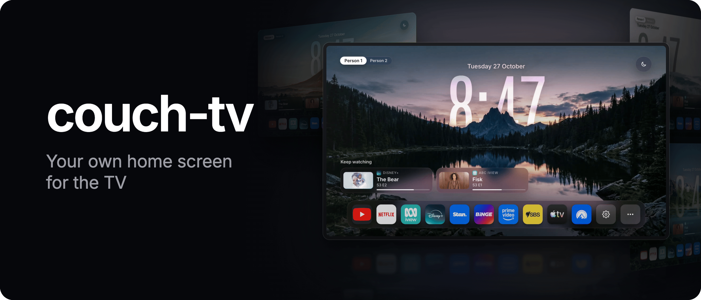
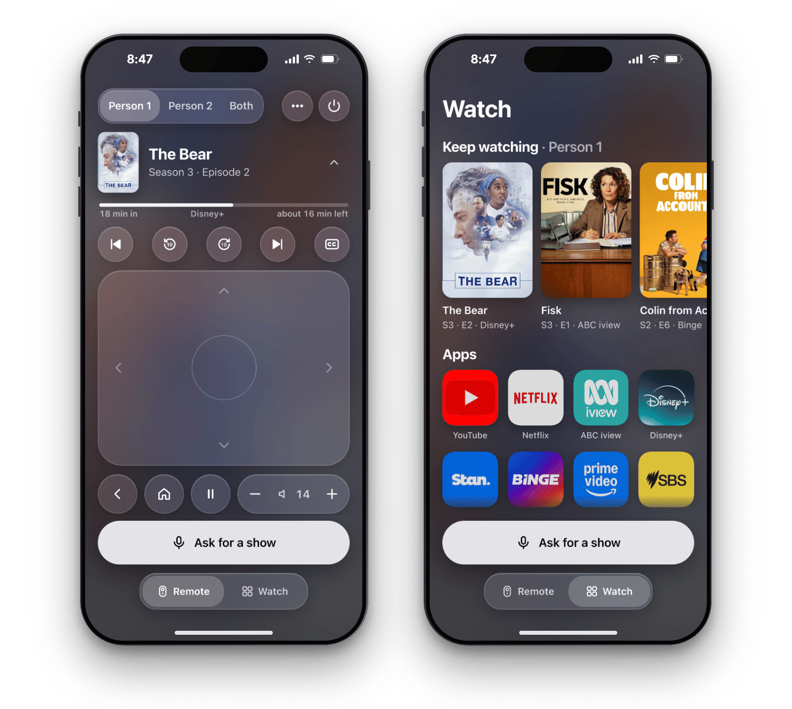
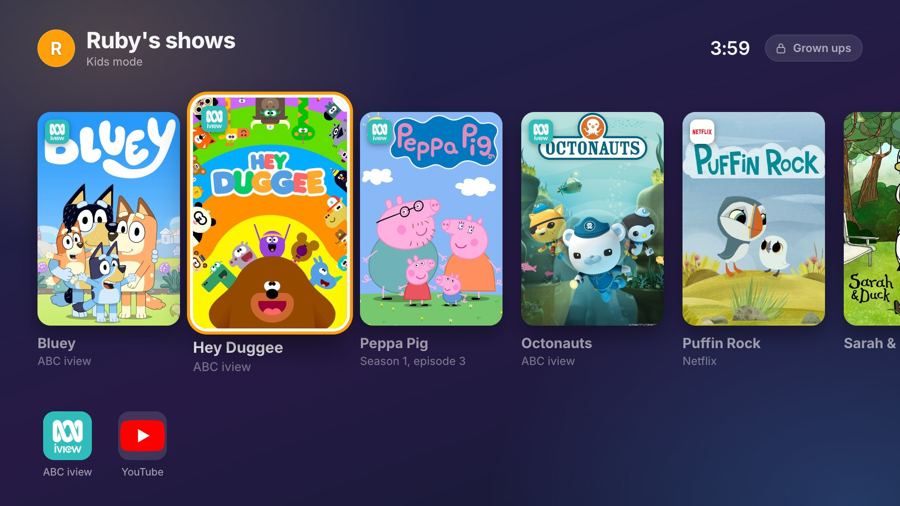
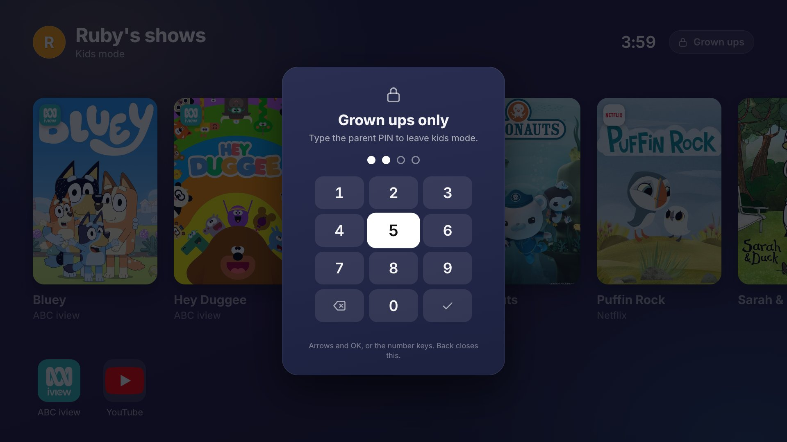
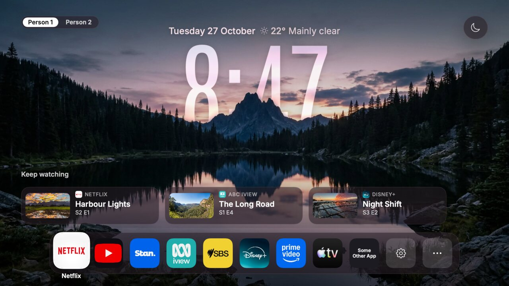
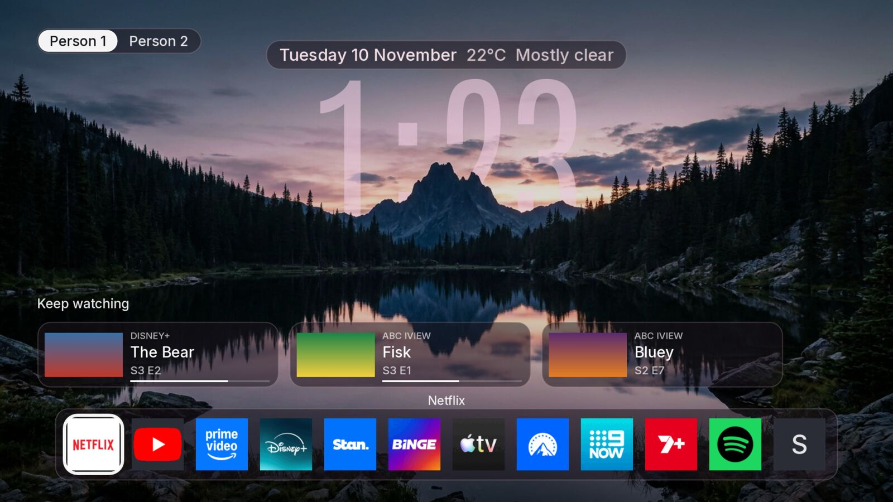
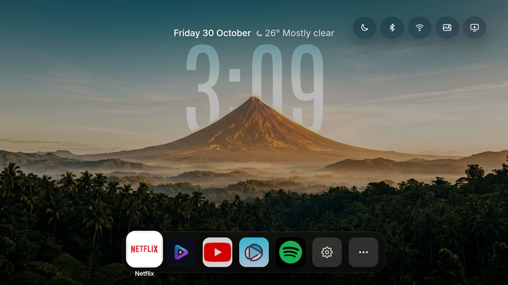

<p align="center"></p>

<p align="center">
  <b>Your own home screen and phone remote for the TV.</b><br>
  Scenes with a glass clock, your apps in your order, Keep watching across apps,
  and a phone remote that finds a show and starts it. No ads on the home screen. Open source.
</p>

<p align="center">
  <a href="https://github.com/Seagey/couch-tv/releases/latest"></a>
  <a href="LICENSE"></a>
  <a href="#will-it-work-on-my-tv"></a>
</p>

<p align="center"><b>
  <a href="#get-started">Set it up</a>
  &nbsp;·&nbsp; <a href="#will-it-work-on-my-tv">Which TVs</a>
  &nbsp;·&nbsp; <a href="docs/README.md">Docs</a>
  &nbsp;·&nbsp; <a href="docs/UPDATES.md">What's new</a>
</b></p>

## Get started

1. **With your AI agent, the easiest way.** Open this folder in Claude Code (or any coding agent)
   and say "set this up on my TV". It reads [AGENTS.md](AGENTS.md), finds your TV, asks which option
   you want and a few questions (who watches, the look, your apps), reads the plan back, and changes
   nothing on the TV until you say yes.
2. **From your phone or a computer:** [couchtv.sites.underseage.studio](https://couchtv.sites.underseage.studio),
   with the free Setup app on a Mac or Windows computer. It also checks whether your TV will work.
3. **By hand:** [docs/SETUP.md](docs/SETUP.md) has every step, from developer mode to the TV home,
   and how to [undo it](docs/SETUP.md#undo-put-the-google-home-screen-back).

> [!NOTE]
> Set couch-tv up with 0.10 or older on a Google TV? 0.11 and newer leave the Google home and setup
> apps switched on. Read [If your TV loops after a restart](docs/TROUBLESHOOTING.md#if-your-tv-loops-after-a-restart)
> before you next restart your TV.

<a name="setup"></a><a name="setting-it-up-with-an-ai-agent"></a><a name="what-you-need"></a><a name="step-1-developer-mode-on-the-tv-every-option"></a><a name="step-2-get-the-code-and-set-up-python-every-option"></a><a name="step-3-pair-the-tv-with-the-bridge-option-b"></a><a name="step-4-build-the-phone-remote-option-b"></a><a name="step-5-run-the-bridge-option-b"></a><a name="step-6-put-the-tv-home-on-the-tv-options-a-and-b-it-becomes-the-home-the-google-home-stays-on"></a><a name="building-the-app-instead-of-downloading-it"></a><a name="undo-put-the-google-home-screen-back"></a><a name="if-your-tv-loops-after-a-restart"></a><a name="troubleshooting"></a><a name="tcl-home-goes-back-to-google-tv-after-every-restart"></a><a name="if-disney-or-another-app-signs-you-out-after-the-tv-turns-off"></a><a name="seeing-every-app"></a>

## Updates

The newest release is **0.12** (9 November 2026), on [the Releases page](https://github.com/Seagey/couch-tv/releases). These are on main, in the next release:

- **13 November:** Bell Streamer's Fibe TV home is replaced by couch-tv (Beta, untested), thanks Sparkybabcia ([#168](docs/UPDATES.md#13-november-2026-bell-streamer-with-fibe-tv-as-its-home-beta-on-main-in-the-next-release))
- **13 November:** Privacy clean (Beta): `PRIVACY=1` switches off known tracking, ad and ACR apps, reversibly ([docs/PRIVACY.md](docs/PRIVACY.md), [details](docs/UPDATES.md#13-november-2026-privacy-clean-beta-on-main))
- **13 November:** the home comes back to the tile you left after Settings, thanks IshMehta ([#166](docs/UPDATES.md#13-november-2026-the-home-comes-back-to-the-tile-you-left-on-main-in-the-next-release))
- **13 November:** on Fire OS 7 Couch TV comes back without the 5 second wait, thanks atul016 ([#162](docs/UPDATES.md#13-november-2026-fire-os-7-brings-couch-tv-back-without-the-5-second-wait-on-main-in-the-next-release))
- **13 November:** the Next song button skips the track again on a Mi Box, thanks NathanGlasby ([#158](docs/UPDATES.md#13-november-2026-the-next-song-button-skips-the-track-again-on-main-in-the-next-release))
- **13 November:** the TV home speaks Hebrew, right to left, thanks YuvalHir ([#153](docs/UPDATES.md#13-november-2026-hebrew-and-right-to-left-layout-on-the-tv-home-on-main-in-the-next-release))

Every change, with credits: [docs/UPDATES.md](docs/UPDATES.md).

## Three ways to run it

- **A. TV home only.** The new home screen, and you use your normal TV remote. No computer has to
  stay on. Set up with [docs/SETUP.md](docs/SETUP.md), steps 1, 2 and 6.
- **B. Computer bridge.** The home, the phone remote, "put on Bluey", turning the TV on from the
  phone, Keep watching across apps and the optional assistant. A Mac, a Linux box or a Raspberry Pi
  at home stays on and runs the bridge. Set up with [docs/SETUP.md](docs/SETUP.md), steps 1 to 6.
- **C. Lives on the TV.** The home and the phone remote with no computer: the bridge runs inside an
  app on the TV. Set up with [on-tv/README.md](on-tv/README.md).

## Will it work on my TV?

A is the TV home only, B adds the computer bridge, C lives on the TV ([the three ways](#three-ways-to-run-it)).

| Your TV | A | B | C |
|---|---|---|---|
| [Google TV](docs/PLATFORMS.md#google-tv-and-android-tv) | Yes | Yes | Partial |
| [Google TV box](docs/PLATFORMS.md#google-tv-and-android-tv) | Yes | Yes | Partial |
| [Older Android TV](docs/PLATFORMS.md#google-tv-and-android-tv) | Yes | Yes | Yes |
| [Android 6 TV](docs/PLATFORMS.md#all-tvs-in-one-table) | Experimental | Not tested | Experimental |
| [XGIMI projector](docs/PLATFORMS.md#all-tvs-in-one-table) | Yes | Not reported | Yes |
| [Nvidia Shield](docs/PLATFORMS.md#google-tv-and-android-tv) | Yes, untested | Yes | Yes, untested |
| [Fire TV on Fire OS](docs/PLATFORMS.md#fire-tv-on-fire-os) | Partial | Partial | Partial |
| [Fire TV on Vega OS](docs/PLATFORMS.md#fire-tv-on-vega-os) | App only | Beta | No |
| [Samsung](docs/PLATFORMS.md#samsung) | App only | As an app | No |
| [LG](docs/PLATFORMS.md#lg) | App only | As an app | No |
| [Roku](docs/PLATFORMS.md#roku) | App only | As a channel | No |
| [Hisense VIDAA](docs/PLATFORMS.md#hisense-vidaa) | App only | Beta | No |
| [Philips with Titan OS](docs/PLATFORMS.md#philips-with-titan-os) | Not yet | Remote only, Beta | No |
| [Older Philips with Saphi](docs/PLATFORMS.md#older-philips-with-saphi) | No | Beta | No |
| [VIZIO](docs/PLATFORMS.md#vizio) | No | Remote only, Beta | No |
| [Panasonic Viera](docs/PLATFORMS.md#panasonic-viera) | No | Beta | No |
| [Apple TV](docs/PLATFORMS.md#apple-tv) | No | Beta | No |
| [TiVo OS](docs/PLATFORMS.md#tivo-os) | No | Beta | No |

**Beta** means a computer at home that stays on, and the maker's own Home button still opens the maker's own home.

**It depends on the model, not the brand.** Open **Settings, System, About** (or **Device Preferences, About**) on the TV: "Android TV OS" means yes ([brand by brand](docs/TV-BRANDS.md)).

**Want everything on a TV that is not Google TV or Android TV?** Plug in a Google TV box (for example the Google TV Streamer) and set couch-tv up on that, and you get everything, on any TV with an HDMI port.

**Test your own TV** (changes nothing on it, and installs nothing outside this folder):

```sh
git clone https://github.com/Seagey/couch-tv.git && cd couch-tv
python3 --version                                  # needs 3.11 or newer
python3 -m venv .venv && .venv/bin/pip install -r bridge/requirements.txt
.venv/bin/python scripts/find-tvs.py               # lists the TVs on your Wi-Fi
.venv/bin/python scripts/check-tv.py <tv address>  # says which options that TV can run
```

It knocks on the ports each kind of TV answers on, so it can tell a Samsung from a Google TV without touching anything. More, including the check by hand and `--adb`: [docs/PLATFORMS.md](docs/PLATFORMS.md#test-your-own-tv).

## Home backgrounds

Five scenes take turns every 20 seconds, each with a big glass clock that sits just behind the
scenery: the peaks, the volcano and the misty hills overlap the digits, and on the lake the clock
floats with its reflection under the water. Or pick the Classic look, your own photos, or
[a scene you design yourself](docs/MAKE-A-SCENE.md).

<p align="center">
  
  
  
  
  
  
</p>

<p align="center"><sub>Night, Golden hour, Waterline, Fog, Dawn and Classic. Shown with sample shows and sample people.</sub></p>

## The phone remote

Your phone becomes the remote: arrows, volume, typing and the power button. Ask for a show by name
("put on Bluey") and couch-tv finds where it streams and starts it in the right app, past "Who's
watching?" on Android TV. There is an optional assistant for "put on something funny": Claude with the
bridge, or Claude and other AI services in on-TV mode. Needs [option B or C](#three-ways-to-run-it).

<p align="center"></p>

<p align="center"><sub><a href="docs/REMOTE.md">The phone remote</a> · <a href="docs/REMOTES.md">TV remotes and keys</a> · <a href="docs/ASK-PROVIDERS.md">Ask with any AI service</a></sub></p>

## Kids mode

A kids profile's home is one shelf of shows you chose, as big posters that open straight into each
show, plus only the apps you allow. No other apps, no settings, no grown ups' Keep watching. Leaving
it needs the parent PIN. Optional, and off unless you set it up.

<p align="center">
  
  
</p>

<p align="center"><sub><a href="docs/TV-HOME.md#kids-mode">How Kids mode works and what it cannot do</a> · <a href="docs/CONFIG.md#kids-mode">Every setting</a></sub></p>

## Settings on the TV

No computer and no `config.json` needed for the everyday settings. Pick the gear in the dock, or
press the remote's own Settings button, and change the language, the place for the weather, the
look and scenes, your apps and their order, the people and the quick buttons, with any remote.

<p align="center"></p>

<p align="center"><sub><a href="docs/TV-HOME.md#home-settings">Every Home setting in full</a></sub></p>

## And a lot more

- **[Keep watching](docs/TV-HOME.md#scenes-and-looks)**: up to 10 shows you were part way through, newest first, per person with options B and C.
- **[Now playing](docs/TV-HOME.md#now-playing)**: the song, the artist and its cover while music plays, with play, pause and skip.
- **[Glass and video](docs/TV-HOME.md#glass-and-video)**: clear glass panels and icons, a liquid glass clock, or a looping video behind it all.
- **[Quick buttons](docs/TV-HOME.md#quick-buttons)**: sleep timer, picture mode, inputs by name, screensaver and more, one press from the home.
- **[Smart home](docs/TV-HOME.md#smart-home)**: air conditioning, scenes and a doorbell card from Home Assistant. Off unless you add it.
- **[Ten languages](docs/TV-HOME.md#languages)**: English, Spanish, Mexican Spanish, Italian, German, French, Turkish, Serbian, Dutch and Hebrew.
- **[Your own photos](docs/TV-HOME.md#your-own-photos)**: from a USB drive, the TV or the web, taking turns with the scenes.
- **[Two TVs, one show](docs/SYNC.md)**: start the same show on two TVs at once, so two rooms do not echo. Experimental.
- **[Updates on the TV](docs/TV-HOME.md#updates)**: off until you say yes. Then the TV tells you about a new version and hands it to Android to install.

## One home, many TVs

The same home on Google TV and Android TV, an app on Apple TV, a channel on Roku, and Fire TV,
Samsung and LG versions, with Beta paths for more.

<p align="center">
  
  
  
</p>

<p align="center"><sub>Apple TV (Beta), Roku and a Fire TV Stick.</sub></p>

## Documentation

| Set up | Use | Your TV |
|---|---|---|
| [Every setup step](docs/SETUP.md) | [The TV home](docs/TV-HOME.md) | [Samsung](docs/SAMSUNG.md) |
| [config.json, every setting](docs/CONFIG.md) | [The phone remote](docs/REMOTE.md) | [LG](docs/LG.md) |
| [On-TV mode, no computer](on-tv/README.md) | [TV remotes and keys](docs/REMOTES.md) | [Roku](docs/ROKU.md) |
| [The bridge in Docker](docs/DOCKER.md) | [Make your own scene](docs/MAKE-A-SCENE.md) | [Fire TV Stick](docs/FIRE-TV-STICK.md) |
| [For your AI agent](AGENTS.md) | [Ask with any AI service](docs/ASK-PROVIDERS.md) | [Hisense VIDAA](docs/VIDAA.md) |
| [Take couch-tv off](docs/UNINSTALL.md) | [All updates](docs/UPDATES.md) | [Apple TV](docs/APPLE-TV.md) |
| [Troubleshooting](docs/TROUBLESHOOTING.md) | [Two TVs in sync](docs/SYNC.md) | [Every brand](docs/TV-BRANDS.md) |
| [Which TVs work](docs/PLATFORMS.md) | [How it works, privacy, limits](docs/HOW-IT-WORKS.md) | [Philips, Panasonic, VIZIO and more](docs/README.md#per-tv) |

Everything else: [docs/](docs/README.md).

<a name="how-it-fits-together"></a><a name="privacy-and-safety"></a><a name="limits"></a><a name="two-tvs-one-show-experimental"></a>

## Credits

- The five scene backgrounds (`scene-*.jpg`) were generated for this project and are free to use.
  The Classic look's photos are Creative Commons from Wikimedia Commons. Both are listed in
  `tv-home/web/backgrounds/CREDITS.md`.
- The streaming app logos in `remote/src/app-logos/` belong to their owners.
- Fonts: Inter and Antonio (both SIL Open Font Licence).
- Show data and posters: JustWatch (credit them if you publish anything built on this).
- Weather: Open-Meteo.
- The doorbell card and Home Assistant scenes on the TV started in the
  [roliusz fork](https://github.com/roliusz/couch-tv).
- The no-computer install for option A came from
  [udhava2-stack](https://github.com/Seagey/couch-tv/pull/14).
- Kids mode: idea from Natalie Bruss (@nataliebruss on Instagram).
- The Bluetooth and Network buttons, Amazon YouTube support and the Fire TV Stick guide came from
  the [killy10o10 fork](https://github.com/killy10o10/couch-tv); the unpaired TV guard from the
  [Justin1491 fork](https://github.com/Justin1491/couch-tv).

<p align="center"><sub>MIT licence, see <a href="LICENSE">LICENSE</a>. Your settings, secrets and watch history stay on your own computer and TV: <a href="docs/HOW-IT-WORKS.md#privacy-and-safety">privacy and safety</a>.</sub></p>
