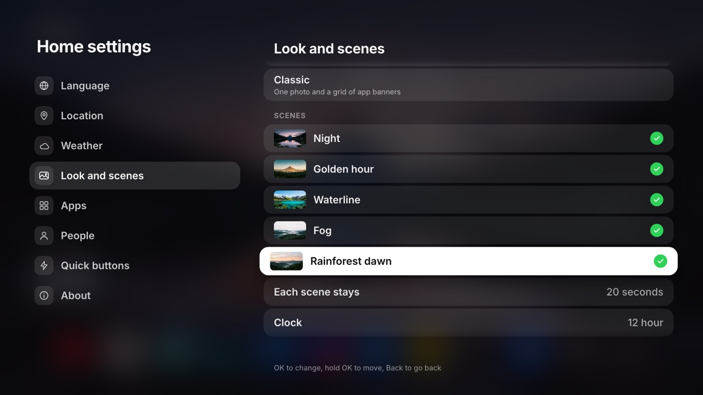

# couch-tv

Your own home screen and phone remote for a Google TV, and now a Samsung TV. No ads on the home
screen. Open source (MIT).


## Updates

**30 October 2026: Fire TV sticks, older TVs, smart home and your own scenes.** Sixteen people
have forked couch-tv so far, and six of them built something worth having. The best of it is now in
the main repo, credited to each of them. Download the new apps from
[the Releases page](https://github.com/Seagey/couch-tv/releases) (or ask your agent to update).

- **Fire TV sticks and Fire TV Cube (Fire OS).** The "lives on the TV" app now takes the Home key
  back: Amazon's own home cannot be switched off, so the app sees it come up and puts couch-tv's
  home straight back on top. Amazon's home still flashes up for a moment first. It needs two
  one-off grants from a computer: [on-tv/README.md](on-tv/README.md#fire-tv-fire-os). Not yet
  tried on a real Fire TV by us: if you have one, an issue saying how it went helps everyone.
- **Older TVs no longer crash on open.** Both TV apps used a part of Android that only Android 11
  and newer have. On Android 9 and 10 (most Fire TV sticks, and many older Android TVs) the home
  crashed as it opened. Fixed and checked on an Android 9 emulator: the old apps crash, the new
  ones open.
- **Keep watching with no computer.** With no bridge (option A), Keep watching now fills from
  Android's own Watch Next list: what each app says you are part way through, with its picture
  and how far in you are.
- **Smart home, if you want it.** If you run Home Assistant, the home can show your air
  conditioning (each room, warmer, cooler, on, off, mode), your scenes as tiles, and a doorbell
  card with the door camera over whatever is playing. It is off for everyone unless they set it
  up, and your agent asks first ([docs/CONFIG.md](docs/CONFIG.md), Smart home).
- **Design your own scene.** Put the glass clock over any photo: a landscape, your own holiday
  shot, anything. Optionally let the skyline sit in front of the clock, like the built-in scenes.
  [docs/MAKE-A-SCENE.md](docs/MAKE-A-SCENE.md).
- **Safer setup.** `apply.sh` now makes couch-tv the chosen home and checks the TV took it before
  it switches anything off (on some TVs the other order can leave Home on a crash-looping setup
  screen). The TV app also checks the settings it is handed more strictly.
- **A build on every change.** GitHub now builds both TV apps for every push and pull request, so
  a change that breaks the build shows straight away.

Thank you to [fifarsi](https://github.com/fifarsi/couch-tv) and
[ishanboss20](https://github.com/ishanboss20/couch-tv) (the Android 9 crash),
[gurpritsingh81](https://github.com/gurpritsingh81/couch-tv) (Watch Next),
[herocode1](https://github.com/herocode1/couch-tv-hero) (the safety fixes and the install order),
[dlandman27](https://github.com/dlandman27/couch-tv) (Fire TV) and
[roliusz](https://github.com/roliusz/couch-tv) (the doorbell, Home Assistant and own scenes).

**29 October 2026: Samsung TVs.** couch-tv now works on Samsung TVs too. It was tested on a 2021
Samsung Frame. It is the same link and the same setup: give this repo to your agent and it offers
the Samsung path when it finds a Samsung.

What is the same on a Samsung: the home (scenes, clock, weather, your apps in your order), the phone
remote, and the Claude assistant. "Put on that show about the lawyer who never went to law school"
finds Suits and plays it.

What is different on a Samsung:

- **You need a computer that stays on at home** (a Mac, a Linux box or a Raspberry Pi on the same
  Wi-Fi, option B below). It opens couch-tv every time the TV is switched on, and it is what the
  phone remote and the assistant talk to. Without it you can only open couch-tv yourself from
  Samsung's app row.
- **It is an app that opens itself, not a true home screen.** Samsung does not let any app replace
  its home. The TV remote's own Home button still opens Samsung's menu; Home on the phone remote
  brings couch-tv back.
- **Playing a show.** Netflix opens the show and starts it by itself. YouTube opens the video.
  Prime Video, Stan, Binge, Paramount+ and Apple TV are handed the title by the couch-tv app on the
  TV, the way Samsung's own guide does it; so far Prime has been seen opening, the title page itself
  is still to be confirmed. Disney+ and the rest open on their home page and you pick the show.
- **No reading the screen.** Samsung gives no screenshots and no "what is playing" to the network.
  So Play is pressed by timing, not by looking (only Netflix's timing is tested so far), and on a
  "Who's watching?" screen couch-tv takes the highlighted profile, usually the first, rather than
  yours by name.
- **You install the app yourself**, with a free tool and your own Samsung account sign-in, after
  turning on the TV's Developer Mode. A firmware update can turn Developer Mode off again; then you
  repeat one step.
- No picture mode switch and no ADB tools (those are Android only).

One bridge can run your Google TVs and your Samsung together, and the phone remote switches between
them. Full guide, limits and undo: [docs/SAMSUNG.md](docs/SAMSUNG.md).

**28 to 29 October 2026, every TV:**

- "Put on X" now gets past "Who's watching?" on Android TVs: it presses your profile (you list your
  names per person, [docs/CONFIG.md](docs/CONFIG.md)) and then Play.
- The phone remote no longer opens to a white page when the phone has just woken up
  ([docs/REMOTE.md](docs/REMOTE.md)).
- The TV home works on older TV browsers too (the 2021 Frame showed no photos and two clocks).

## Home backgrounds

Five scenes take turns every 20 seconds, each with a big glass clock that sits just behind the
scenery: the peaks, the volcano and the misty hills overlap the bottom of the digits, and on the
waterline scene the clock floats on the lake with a blurred reflection under the surface. Your apps
and "keep watching" stay put. Start on one with `?scene=<name>`, or swap in your own photos.
**Design your own scene** (any photo, or a place you describe, with your own clock and date over
it, and the skyline in front of the clock if you like): [docs/MAKE-A-SCENE.md](docs/MAKE-A-SCENE.md).

| Night | Golden hour | Waterline |
|---|---|---|
|  |  |  |
| **Fog** | **Dawn** | **Classic** (`?theme=classic`) |
|  |  |  |

Shown with sample shows and sample people. On your TV, "keep watching" fills from what you
actually watch.

## Settings on the TV

No computer and no `config.json` needed for the everyday settings. Press down to the dock and
pick the gear, **Settings** (just before More apps). OK opens a small menu: **Home settings** is
couch-tv's own list, **TV settings** is Android's own (Wi-Fi, picture, sound).



Any remote works: up and down move, right or OK opens a section, OK changes a row, holding OK on a
scene, an app, a person or a quick button picks it up so up and down move it, and Back steps back
and then closes. What you change shows when the list closes.

- **Language:** English, Español, Español (México).
- **Location:** type a town or city with the TV's on-screen keyboard (or the phone remote's Type),
  pick it from the places found. It sets the weather's place and time zone. The place search is
  Open-Meteo's, free and with no key.
- **Weather:** show or hide it, °C or °F, check every 15, 30 or 60 minutes. Open-Meteo is the only
  weather provider for now.
- **Look and scenes:** Night scenes or Classic; which scenes take turns, in what order, how many
  seconds each; a 12 or 24 hour clock; your own photos (below).
- **Apps:** every app on the TV. OK moves it between home, More apps and hidden; hold OK to change
  the order. The same order as holding OK on the dock and the phone's Arrange apps.
- **People:** add, rename, remove and reorder who is watching.
- **Quick buttons:** which of the sleep timer, picture mode, look and input buttons show, in what
  order.
- **About:** the version, the GitHub address (github.com/Seagey/couch-tv), where the settings are
  kept, and Reset.

**Your own photos.** On a TV with a file picker, **Add photos from a USB drive or this TV** opens it
and copies the photos you choose into the app (turned the right way up and sized for the screen).
Many Android TV and Google TV builds have no file picker; then the list says so and you add a photo
from a web address instead (a JPEG or PNG on the internet, which the TV loads each time). The on-TV
app (option C) only takes web addresses. Your photos take turns with the scenes and replace the
Classic look's own. Videos are not supported: a looping video under the glass clock and the
blurred dock is heavy work for a small TV stick, and the clock's frosted fill is cut from a still
photo.

**Smart home (optional).** If you already run Home Assistant, the home can show your air
conditioning (each room's temperature, warmer, cooler, on, off and mode), your scenes and scripts
as tiles, and a doorbell card with the door camera's picture over whatever is playing. It is off
unless you add a `home_assistant` section to `config.json`; without it nothing changes.
[docs/CONFIG.md](docs/CONFIG.md), Smart home, has the setup.

**Where they are kept.** On the TV, and with option B on the computer too, so the phone agrees and a
reset TV gets them back. They win over `config.json` on that TV; About, Reset home settings goes
back to it. [docs/CONFIG.md](docs/CONFIG.md) has the details.

**Languages.** The TV home and the phone remote both speak English, Spanish (`es`, for Spain and
everyone else) and Mexican Spanish (`es-MX`: computadora, celular, presionar, clima and the rest).
The phone has its own choice (TV menu, Language), "Same as the TV" by default. Messages that come
from the bridge itself (an error, a note about how a show opened) and some screen reader labels on
the phone are still in English.

## Three ways to run it

- **A. TV home only.** The new home screen, nothing else. You use your normal TV remote and no
  computer has to stay on.
- **B. Computer bridge.** The home screen plus the phone remote, "put on Bluey" search, turning the
  TV on from the phone, keep watching across apps and an optional Claude assistant. A computer at
  home (a Mac, a Linux box or a Raspberry Pi) stays on and runs the bridge.
- **C. Lives on the TV.** The home screen and the phone remote with no computer: the bridge runs
  inside an app on the TV. See [on-tv/README.md](on-tv/README.md).

> **Pick your option, then follow only its steps**
> - **A:** steps 1, 2 and 6 below.
> - **B:** steps 1 to 6 below.
> - **C:** [on-tv/README.md](on-tv/README.md) (it has its own developer mode and install steps).

## Will it work on my TV?

| Your TV | A. TV home only | B. Computer bridge | C. Lives on the TV |
|---|---|---|---|
| **Google TV** (Sony, TCL, Hisense Google TV, Philips and others) | Yes | Yes | Partial. Newer models may ask for a pairing code again after a restart |
| **Google TV box** (Google TV Streamer, Chromecast with Google TV, Onn) | Yes | Yes | Partial, as above |
| **Older Android TV** (Android 9 to 11) | Yes | Yes | Yes |
| **Nvidia Shield** | Yes (not tested) | Yes | Yes (not tested) |
| **Fire TV on Fire OS** (Fire TV Stick 4K Max, Fire TV Cube) | Partial. Workarounds only, and Amazon's home flashes up first | Partial | Yes, and it takes the Home key back ([how](on-tv/README.md#fire-tv-fire-os)) |
| **Fire TV on Vega OS** (newer Fire TV sticks) | No | No | No |
| **Samsung** (Tizen) | App only, opened from Samsung's app row | With a computer at home: yes, as an app that opens itself, not a true home screen ([how](docs/SAMSUNG.md)) | No |
| **LG** (webOS) | Possible, untested ([research](docs/LG.md)) | Possible, untested | No |
| **Roku, Apple TV, Hisense with VIDAA** | No | No | No |

**Hisense, Sharp and other brands that sell more than one kind of TV:** it depends on the model,
not the brand. Their Google TV and Android TV models should work. Their VIDAA models run
Hisense's own system and do not. Open **Settings, System, About** (or
**Device Preferences, About**): "Android TV OS" means yes. Or run `scripts/check-tv.py`.
Brand by brand (TCL, Philips, Panasonic, Sharp, Xiaomi and more, untested):
[docs/TV-BRANDS.md](docs/TV-BRANDS.md).

**What you can and cannot do on each:**
- **Google TV and Android TV:** everything in this repo. Your own home screen, your apps in your
  order, the phone remote, finding and playing shows, the sleep timer. Some Google Home features and
  the YouTube button on the remote can stop working once the Google home is switched off.
- **Fire TV (Fire OS):** the phone remote and app launching work. Amazon does not let another home
  screen replace its own, so the "lives on the TV" app (option C) watches for Amazon's home and puts
  couch-tv's home back on top; Amazon's home still flashes up for a moment first. It needs two
  one-off ADB grants: [on-tv/README.md](on-tv/README.md#fire-tv-fire-os).
- **Samsung:** it does not run Android apps and it locks its home screen, so couch-tv goes on as a
  Samsung app (you install it with a free tool and your own Samsung sign-in), and the bridge opens
  it every time the TV is switched on, so it needs a computer that stays on. Samsung's own Home
  button still opens Samsung's menu. The phone remote and the assistant work: Netflix plays the
  show by itself, YouTube opens the video, Prime Video, Stan, Binge, Paramount+ and Apple TV are
  handed the title, and other apps open on their home page. No "what is playing" and no
  screenshots. Setup and limits: [docs/SAMSUNG.md](docs/SAMSUNG.md).
- **LG:** the same approach should work (LG has a Developer Mode and a network remote), but nobody
  has tried it yet: [docs/LG.md](docs/LG.md).
- **Roku, Apple TV, VIDAA and Vega OS Fire TV:** closed. Nothing here works on them.

**Want everything on a Samsung, LG or another TV?** Plug in a Google TV box (for example the Google
TV Streamer) and set couch-tv up on that. You then get everything, on any TV with an HDMI port.

**Test your own TV** (changes nothing on it, and installs nothing outside this folder):

```sh
git clone https://github.com/Seagey/couch-tv.git && cd couch-tv
python3 --version                                  # needs 3.11 or newer
python3 -m venv .venv && .venv/bin/pip install -r bridge/requirements.txt
.venv/bin/python scripts/find-tvs.py               # lists the TVs on your Wi-Fi
.venv/bin/python scripts/check-tv.py <tv address>  # says which options that TV can run
```

It knocks on the ports each kind of TV answers on (Android TV, Samsung, LG, Roku, Apple), so it
can tell a Samsung from a Google TV without touching anything. Or, by hand: on the TV open
**Settings, System, About** (Google TV) or **Settings, Device Preferences, About** (Android TV 9 to
11). If you see "Android TV OS", it works. Details and sources:
[docs/TV-COMPATIBILITY.md](docs/TV-COMPATIBILITY.md).

Later, once Developer options are on (step 1), `check-tv.py <tv address> --adb` also reads the
Android version and the maker. That one makes the TV ask "Allow USB debugging?" and saves this
computer's key in `~/.android/adbkey`, so it waits until you have decided to go ahead.

## Setting it up with an AI agent

Open this folder in Claude Code (or any coding agent) and say "set this up on my TV". It reads
[AGENTS.md](AGENTS.md) and asks you two things before it touches anything: which TV you have, and
which option you want.

This repo is **two separate things**. You can use the first without the second, but the second
needs the first's TV set up the same way (developer mode on).

| | 1. The TV home | 2. The phone remote and bridge |
|---|---|---|
| What it is | An Android TV app that replaces the Google TV home screen. Scenes, clock, weather, your app row, "keep watching". | A phone web app (the remote) and a small Python service (the bridge) that runs on a computer at home and talks to the TV. |
| Where it lives | `tv-home/` (`android/` is the app, `web/` is its screen) | `remote/` (phone app) and `bridge/` (the service) |
| Runs on | The TV | Your phone, plus a computer that stays on |
| Options | A and B | B (C has its own app, in `on-tv/`) |

## What you need

**For every option:**
- A **Google TV or Android TV** (Android 9 or newer) with Developer options and debugging on
  (step 1).
- A computer on the same Wi-Fi to set it up from: macOS or Linux with **Python 3.11 or newer**
  (`python3 --version`). Missing or older: on macOS `brew install python@3.11` or the installer
  from python.org; on Linux your distribution's package (for example `sudo apt install python3.11
  python3.11-venv`). On a Mac the first `python3` or `git` may ask to install the developer tools:
  say Install, it takes a few minutes. For option A that computer can go back in the cupboard
  afterwards.
- The TV app, `couch-tv-home.apk`: **download it from the GitHub Releases page**, or build it
  yourself ("Building the app" below).

**Option B also needs:**
- An **always-on computer on the same Wi-Fi**: a Mac or a Linux box (a Raspberry Pi is fine).
  The bridge has to be running whenever you want the remote.
- **Node 20 or newer**, once, to build the phone app.
- Optional, **Claude "ask"** ("put on something funny"): the Claude Code program, installed and
  logged in to your own Claude plan. It runs `claude -p` and strips `ANTHROPIC_API_KEY` from the
  environment first, so it never bills an API key. It is off in `config.example.json`; turn it on
  (`"ask": {"enabled": true}`) once Claude Code works on that computer.
- Where a show streams: nothing to set up. The bridge asks JustWatch's public search (no key) for
  the country in `config.json` (`"country": "AU"`, or `"US"`, `"GB"` and so on).
- A free **TMDB key is not needed** by this code. If you add your own poster lookup, put the key in
  `.env` (see `env.example`). Never commit it.

**The home with the computer off (option B):** the app carries its own copy of the home and also
keeps the bridge's latest copy. If the computer is off, the TV still shows the clock, the weather
and your app row. It only loses "keep watching" and the picks. With option A that copy is the home.

## Setup

### Step 1. Developer mode on the TV (every option)

Do this on the TV itself.

1. Open **Settings**, then **System**, then **About** (Google TV). On Android TV 9 to 11 it is
   **Settings, Device Preferences, About**.
2. Go right down to **Android TV OS build** (or **Build**). Press OK on it **seven times**. A
   countdown appears, then "You are now a developer!".
3. Go back. There is a new menu called **Developer options** (under System, or Device Preferences).
4. Find **USB debugging** and switch it on.
5. If there is also a **Network debugging** switch (also called ADB over network or ADB
   debugging), switch it on too. Some TVs have no such switch: on a TCL with Android TV 11, USB
   debugging alone opened the network port. Either way, check from the computer:
   `.venv/bin/python scripts/check-tv.py <tv address>`. If it says ADB is open on port 5555,
   everything in this repo works as it is. If it says only Wireless debugging is on, see the box
   below.
6. Find the TV's address: **Settings, Network and Internet, your Wi-Fi** (or **Settings, Network,
   your Wi-Fi, details**). It looks like four numbers with dots. Give the TV a fixed address in your
   router if you can, so it never changes.

The first time a computer connects, the TV asks "Allow USB debugging?". Tick **Always allow**
and press **Allow**. You never see it again.

> **Allow every computer before you switch the Google home off.** Seen on one Google TV
> (Android 14): after `apply.sh` switched off the Google TV home and its setup app, the TV no longer
> showed "Allow USB debugging?" for any new computer. Computers allowed before that kept working.
> So connect each computer you will use (`check-tv.py <tv address> --adb`, and for option C the
> app's **Connect ADB**) and press Allow **before** step 6. If it already happened, see "If
> something is stuck" in [docs/UNINSTALL.md](docs/UNINSTALL.md).

> **Only Wireless debugging?** Newer Google TVs (Android 11 and up) may offer only **Wireless
> debugging**, which pairs with a code and uses a random port that changes after a restart.
> couch-tv's scripts and the bridge speak plain ADB on a fixed port, so turn the fixed port on once
> with Google's own tools ([Android platform-tools](https://developer.android.com/tools/releases/platform-tools)):
> 1. On the TV: Developer options, **Wireless debugging** on, then **Pair device with pairing
>    code**. It shows a code and an address with a port, for example `<tv address>:37123`.
> 2. On the computer: `adb pair <tv address>:<pairing port> <code>`.
> 3. Back on the Wireless debugging screen, note the port under "IP address and port", then
>    `adb connect <tv address>:<that port>`.
> 4. `adb tcpip 5555`. Port 5555 is now open and `check-tv.py` should say ADB is open on port 5555.
>
> On some TVs port 5555 closes again after a restart. Then run steps 2 to 4 again (option B's
> daily guard and the remote need it open). If your TV keeps a different fixed port open, set
> `"adb_port"` on that TV in `config.json` (or `ADB_PORT=<port>` for the scripts). The Wireless
> debugging port itself needs Google's `adb`; couch-tv cannot use it directly.

> **Mac: "allow devices on your local network".** macOS asks once per program before it lets it
> talk to devices at home. Say **Allow** for Terminal (or the app your AI agent runs in). A program
> that is new to the Mac, like Google's `adb` straight after downloading it, can be blocked
> silently: it then cannot reach the TV although everything else can. couch-tv's own tools
> (`tv-home/tools/tvadb.py`, `on-tv/scripts/real-tv.py`, `check-tv.py`) are plain Python and run
> inside the Python you have already allowed, so use them for everything except the one-off
> Wireless debugging pairing above. If `adb` is blocked: System Settings, Privacy and Security,
> Local Network, and switch on the app it runs in.

### Step 2. Get the code and set up Python (every option)

```sh
git clone https://github.com/Seagey/couch-tv.git
cd couch-tv
python3 --version                    # 3.11 or newer
python3 -m venv .venv
.venv/bin/pip install -r bridge/requirements.txt
cp config.example.json config.json
```

Edit `config.json` (it is private, it never gets committed):

- `tvs`: put your TV's address in `ip`. Give it a name. Add more TVs by adding more entries.
- `people`: the names that show on the "who is watching" switch, any number. None or one: no
  switch. Two: a switch. Three or more: a round head icon that opens a list. Mark children with
  `"kid": true` and visitors with `"guest": true` so they stay out of the household's picks.
- `weather`: your latitude, longitude, place name and time zone (Open-Meteo, free, no key). A
  suburb or city, never a home address.
- `country`: two letter code, for where shows stream.
- Option B: `bridge.host`, the name of the computer that runs the bridge, for example
  `my-computer.local`.
- Optional: `home` (scenes, how long each stays, 12 or 24 hour clock, how many apps in the dock,
  apps to hide), `quick` per TV (sleep timer, picture mode, look and input buttons), `ask` and
  `phone_remote`.

Every key, with its default: [docs/CONFIG.md](docs/CONFIG.md). Which TV remotes work and which
keys do what: [docs/REMOTES.md](docs/REMOTES.md). How the phone remote is hosted and how to add it to
your phone: [docs/REMOTE.md](docs/REMOTE.md).

Optional settings (port, Claude location) go in `.env`. Copy `env.example` to `.env`.

### Step 3. Pair the TV with the bridge (option B)

```sh
.venv/bin/python bridge/pair_tv.py living-room
```

The TV shows a 6 character code. Type it in and press Enter. That pairs the bridge as a remote (the
TV lists it as "Couch TV bridge"). An AI agent cannot type into the waiting script: it runs that
command in the background, asks you to read the code off the TV, then runs
`.venv/bin/python bridge/pair_tv.py living-room --code <the code>`.

Then:

```sh
.venv/bin/python bridge/pair_tv.py living-room --adb
```

The TV asks "Allow USB debugging?". Tick Always allow, then Allow. The keys it makes are stored on
your computer (`bridge/data/` and `~/.android/adbkey`). They are in `.gitignore`.

### Step 4. Build the phone remote (option B)

```sh
cd remote
npm ci
npm run build
cd ..
```

### Step 5. Run the bridge (option B)

```sh
.venv/bin/python bridge/server.py
```

Open `http://your-computer.local:5400` on your phone (same Wi-Fi). Add it to your home screen.
To keep the bridge running all the time, use `bridge/examples/couch-tv-bridge.plist.example`
(macOS) or `bridge/examples/couch-tv-bridge.service.example` (Linux). Both set `CLAUDE_BIN` and a
`PATH`, because a background service does not see your shell's.

**Anyone on your Wi-Fi can use the remote and the assistant.** The bridge has no password, so
everyone on the network, kids included, can change the channel, turn the TV off or ask Claude for
a show. Put visitors on a guest Wi-Fi network (most routers have one) so they cannot reach it. The
bridge is for your home network only. Never put it on the internet or forward a port to it.

`"phone_remote": false` is for a house that only wants the TV home and its quick settings from the
bridge. The bridge still serves the API (the TV home needs it), and the phone page still loads if
someone opens it, so the same rule applies.

### Step 6. Put the TV home on the TV (options A and B; this replaces the Google home screen)

Get `couch-tv-home.apk` from the GitHub Releases page (or build it, below). Look at the TV first
(it changes nothing):

```sh
TV_IP=<your tv address> .venv/bin/python tv-home/tools/survey-tv.py
```

It also reminds you that switching the setup wizard off makes some TVs forget their Wi-Fi. Nothing
can tell in advance which TVs, so plan for it on any TV: have the TV remote ready.

Then install it. **Option A** (no computer stays on):

```sh
TV_IP=<your tv address> APK=couch-tv-home.apk sh tv-home/tools/apply.sh
```

**Option B** (the home loads from the bridge):

```sh
TV_IP=<your tv address> APK=couch-tv-home.apk BRIDGE_URL=http://my-computer.local:5400 sh tv-home/tools/apply.sh
```

This installs the app, switches off the Google TV home (and ambient mode, the setup wizard and any
ad trackers you name in `EXTRA_OFF`), and makes the new home the TV's home. Other makers' own home
screens are left alone; the TV's default home is set to couch-tv instead. Nothing is deleted.
It also hands the app your `config.json` settings (people, weather, clock, look, quick buttons)
for its built-in copy. **Read the Undo section before you run it.**

The setup wizard goes off last, after everything else is done. If the TV then forgets its Wi-Fi,
`apply.sh` says so: join the Wi-Fi again at the TV (Settings, Network and Internet) and run the
same command again. It is safe to run as often as you like.

- `KEEP_SETUP=1` leaves the setup wizard on, so the Wi-Fi is never at risk. On some TVs the
  wizard then keeps winning the Home button; if it does, the wizard has to go off.
- **A Google TV update can switch the Google home back on.** With option B the bridge checks once
  a day and switches it off again. With option A there is no bridge: run `apply.sh` again after an
  update (and after you change `config.json`).

### Building the app (instead of downloading it)

You need **JDK 21** and the **Android SDK** with platform 34 and build tools 34. Gradle is not
needed: `tv-home/android/gradlew` fetches Gradle 8.11.1 by itself.

1. JDK 21. The simplest way, with no password needed: download the Temurin 21 JDK `.tar.gz`
   for your computer from [adoptium.net](https://adoptium.net/temurin/releases/?version=21), unpack
   it into a folder you own (for example `couch-tv/build/jdk`, which git ignores) and point
   `JAVA_HOME` at it (on macOS the `Contents/Home` folder inside). Or install it system-wide:
   macOS `brew install --cask temurin@21` (asks for your password), Linux
   `sudo apt install openjdk-21-jdk`.
2. The Android SDK command line tools: download "Command line tools only" from
   [developer.android.com/studio](https://developer.android.com/studio), unzip into
   `~/Library/Android/sdk/cmdline-tools/latest` (macOS) or `~/Android/Sdk/cmdline-tools/latest`
   (Linux).
3. Then, with `ANDROID_HOME` set to that `sdk` folder:
   ```sh
   $ANDROID_HOME/cmdline-tools/latest/bin/sdkmanager "platforms;android-34" "build-tools;34.0.0"
   $ANDROID_HOME/cmdline-tools/latest/bin/sdkmanager --licenses     # answer y to each licence
   ```
4. Build:
   ```sh
   JAVA_HOME=/path/to/jdk-21 ANDROID_HOME=/path/to/android-sdk sh scripts/build-apk.sh
   ```
   It prints where the APKs are (`dist/couch-tv-home.apk`, plus `dist/couch-tv-ontv.apk` for
   option C). The on-TV app carries the phone remote inside it, so for that one the script builds
   `remote/` first, which needs **Node 20 or newer**. `apply.sh` finds `dist/couch-tv-home.apk`
   by itself.

The release APK is signed with your local debug key, which is fine for your own TV. The built-in
copy uses `config.example.json` unless you pass `CONFIG=config.json`; `apply.sh` hands the TV your
own settings either way.

## Undo: put the Google home screen back

The full guide, with the TV-remote-only way and what to do if something is stuck:
[docs/UNINSTALL.md](docs/UNINSTALL.md). In short:

1. **Option B: stop the bridge first**, or its daily guard switches the Google home off again
   (macOS: `launchctl bootout gui/$(id -u)/app.couchtv.bridge`; Linux:
   `systemctl --user disable --now couch-tv-bridge`).
2. Everything off, including developer mode:
   `TV_IP=<your tv address> DEV_OFF=1 sh tv-home/tools/remove-all.sh`. If the computer cannot reach
   the TV it says so, changes nothing and prints the TV-remote steps.

Only the home screen, keeping the app (10 seconds): `TV_IP=<your tv address> sh tv-home/tools/undo.sh`.
It switches back on exactly what `apply.sh` switched off, and makes the home the TV had before the
home again. To remove the app as well, after that:
`TV_IP=<your tv address> .venv/bin/python tv-home/tools/tvadb.py shell "pm uninstall app.couchtv.launcher"`.

With only the TV remote (no computer):

1. On the couch-tv home, open the **Settings** tile (the gear at the end of the app row), or press
   the Settings button on your remote.
2. **Apps**, then **See all apps**, then **Show system apps**.
3. Open **Google TV Home** (it says Disabled) and press **Enable**. Do the same for **Setup** (the
   Google TV setup app). Ambient mode and the ad tracker are optional.
4. Back in **Apps**, open **Home** (the new one) and press **Uninstall**.
5. Press the Home button. Google TV is back.

Do step 3 before step 4. If the new home is removed while Google TV Home is still off, the TV has
no home screen. Apps still open from the remote's app buttons, and the computer undo above still
works.

If the TV ever loses its saved Wi-Fi after switching the setup wizard off, enable **Setup** again
(step 3) and set the Wi-Fi from there.

## How it fits together

```
phone remote (remote/)  --->  bridge (bridge/, always-on computer)  --->  the TV
TV home (tv-home/)      --->  bridge (for shows and picks)               (Android TV Remote
                              TV home carries its own copy for when       protocol and ADB)
                              there is no bridge
```

- API contract: [bridge/API.md](bridge/API.md).
- How shows open in each streaming app: [bridge/DEEPLINKS.md](bridge/DEEPLINKS.md).
- Watch history, taste and picks stay on your computer in `bridge/data/`. That folder is in
  `.gitignore`. You can import your own Netflix and YouTube history: [bridge/IMPORT.md](bridge/IMPORT.md).

## Privacy and safety

- Your settings are in `config.json`, your secrets in `.env`, your data in `bridge/data/`. All
  three are ignored by git.
- Before you push a fork, run `scripts/privacy-scan.sh`. It checks for private addresses, emails,
  phone numbers, MAC addresses, home network names and secrets, in the files and the git history.
  You can also give it a file of your own words to block: `scripts/privacy-scan.sh my-denylist.txt`
  (one word per line, keep that file out of the repo). `scripts/install-hook.sh my-denylist.txt`
  runs it before every commit.
- Option B: anyone on your Wi-Fi can use the remote and the assistant (see step 5). The bridge only
  listens on your home network. Do not forward a port to it.
- Smart home (optional, off unless you add it): the Home Assistant token goes in `.env`, then
  only into the TV app's private storage. The home page never sees it, and the app only touches the
  rooms, scenes and doorbell you list. Make a separate Home Assistant user for the TV
  ([docs/CONFIG.md](docs/CONFIG.md), Smart home).

## Limits

- Google TV and Android TV run everything. Fire TV (Fire OS) runs the on-TV app, with Amazon's
  home flashing up first. Samsung runs it as an app, with a computer that stays on. Developer
  mode has to be on.
- A Google TV update can switch the Google home back on. Option B's bridge checks once a day and
  switches it off again; with option A, run `apply.sh` again.
- Some apps will not open a show directly. They open the app instead. See `bridge/DEEPLINKS.md`.
- The bridge's own messages (errors, notes) are in English in every language.
- No support promise. It works on the TVs it was built on. Your TV may differ.

## Credits

- The five scene backgrounds (`scene-*.jpg`) were generated for this project and are free to use.
  The Classic look's photos are Creative Commons from Wikimedia Commons. Both are listed in
  `tv-home/web/backgrounds/CREDITS.md`.
- The streaming app logos in `remote/src/app-logos/` belong to their owners.
- Fonts: Inter and Antonio (both SIL Open Font Licence).
- Show data and posters: JustWatch (credit them if you publish anything built on this).
- Weather: Open-Meteo.
- The doorbell card and Home Assistant scenes on the TV started in the
  [roliusz fork](https://github.com/roliusz/couch-tv).

MIT licence, see `LICENSE`.
