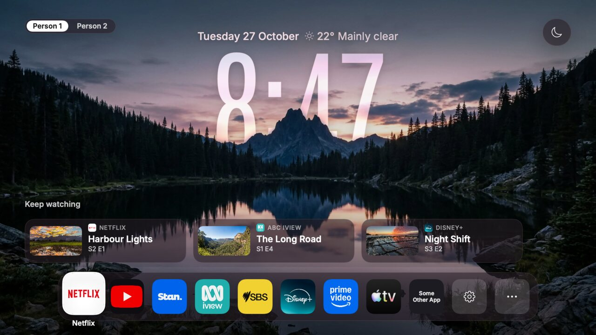
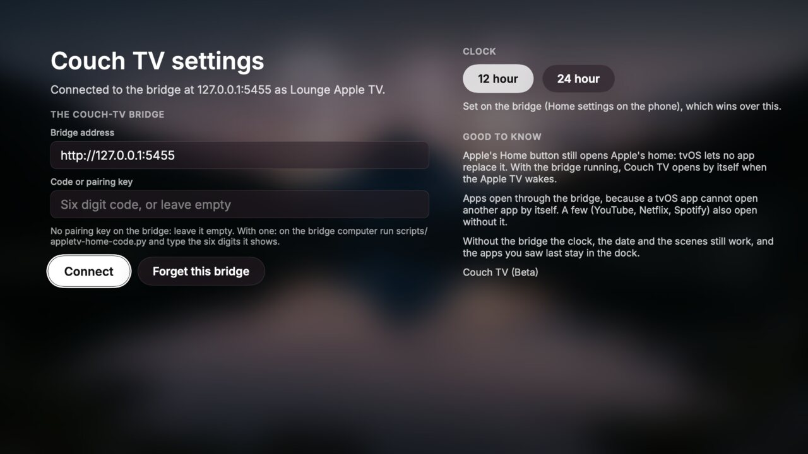
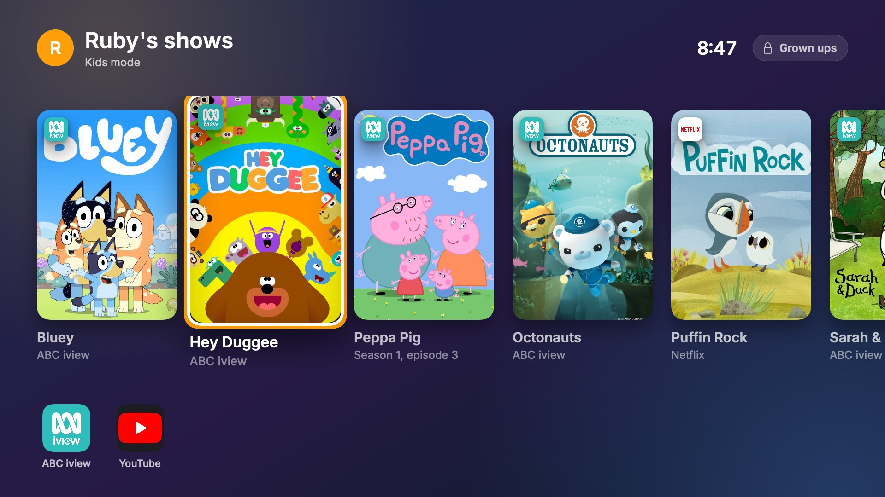
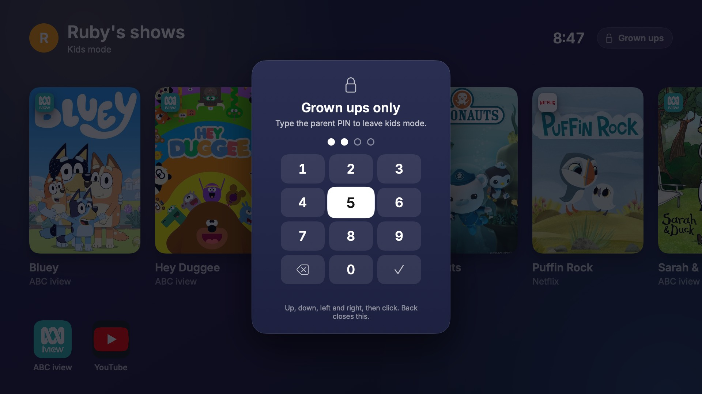

# couch-tv on an Apple TV (Beta)

**New, Beta.** Two parts: the phone remote (the bridge talks to the Apple TV) and **Couch TV**, couch-tv's home as an
Apple TV app. Both were built and checked against a stand-in Apple TV and a stand-in bridge on a computer, and Couch TV also runs in
the tvOS Simulator. No real Apple TV has run them yet, so expect something to need fixing. Please [open an issue](https://github.com/Seagey/couch-tv/issues)
and say how it went (the Apple TV model, tvOS version, what worked and what did not), even if all of it worked.

## What you get, in plain words

| | Apple TV |
|---|---|
| Phone remote: arrows, OK, Back, Play/Pause, Apple's Home, volume keys | Yes, with the bridge running (option B, a computer at home that stays on) |
| Sleep and wake from the phone | Yes |
| Opening an app from the phone (Netflix, YouTube, Disney+, Prime Video, Apple TV and the rest the Apple TV lists) | Yes. The app opens on its own home page: pick the show there, nothing presses Play for you |
| "Put on Bluey" (find and play) | Finds where it streams, opens that app. No deep link into the show |
| couch-tv's home screen on the TV | **New, Beta:** Couch TV, an app with the same scenes, glass clock, date and weather, people switch, Keep watching and dock as the other TVs. You put it on the Apple TV yourself with Xcode on a Mac ([below](#the-home-app-couch-tv)) |
| Opening couch-tv by itself when the Apple TV wakes | Yes, once Couch TV is installed and the bridge is running, like the Samsung and LG paths |
| Replacing or coming before Apple's own home screen | **No, and it cannot be done.** tvOS lets no app replace the home, and couch-tv never jailbreaks anything. Apple's Home button still opens Apple's home |
| Typing from the phone, screenshots, what is playing, a volume level | No (see "Limits") |
| More than one TV on one phone remote | Yes, like the Roku and the LG: one bridge, several entries in `config.json` |
| Kids mode (only a shelf of shows you picked, behind a parent PIN) | **New, Beta:** in Couch TV, with the bridge. Netflix, Disney+, Apple TV and YouTube posters open the show, other apps open on their home. Pair it with Apple's Restrictions ([Kids mode](#kids-mode)) |

The phone remote costs nothing and needs no Apple account. Couch TV is free with your own Apple ID, but Apple makes a
free signature run out after 7 days, so a Mac at home signs it again twice a week (a script does it).

## How it works

The bridge talks to the Apple TV over the network the way the iPhone's Control Centre remote does, using
Apple's Companion Link protocol. You pair once (the Apple TV shows a 4 digit PIN), then every connection
is checked and sealed with keys made on your computer. couch-tv makes its own keys: nothing of Apple's is
included, and the keys stay in `bridge/data/` (git ignores it, the file is private to your user). The
Apple TV lists couch-tv's computer under Settings, Remotes and Devices, and you can remove it there.

Written from public descriptions of the protocol (see the sources below). The best known open source
library for it is [pyatv](https://pyatv.dev/); couch-tv's code is its own and was not copied from it.

## Set it up

Needs the bridge running on a computer that stays on (README, option B), on the same network as the Apple TV.

1. Wake the Apple TV. Run `.venv/bin/python scripts/appletv-check.py` (it only listens) to find it and its
   address and port. The port is announced on the network and can change after a restart.
2. Add it to `config.json`:

   ```json
   { "id": "lounge-appletv", "name": "Lounge Apple TV", "kind": "appletv", "ip": "<its address>", "port": 49153 }
   ```
3. Pair once: `.venv/bin/python scripts/appletv-check.py <address> --port <port> --pair` and type the PIN the
   Apple TV shows. Or, with the bridge running, `POST /api/appletv/pair` with `{}`, then with `{"pin": "1234"}`.
4. Start the bridge. The phone remote now shows the Apple TV.

Give the Apple TV a fixed address in your router so it never moves.

## The home app: Couch TV

tvOS has no web view, so the web page every other TV shows cannot run on an Apple TV. Couch TV (`tvos/`) draws the
same home again as a native SwiftUI app for tvOS 17 and newer:

- The five scenes (the same pictures as the other TVs, from `tv-home/web/backgrounds`) taking turns, each with its
  glass clock: the frosted photo seen through the digits, the scenery cut out in front of them, and the reflection
  on the water scene.
- The date and the weather, the people switch, the sleep timer, Keep watching, and the dock with your apps, then
  Settings and More apps. A kids profile sees only their shelf and allowed apps ([Kids mode](#kids-mode)). The Siri remote moves between them with tvOS's own focus, like any Apple TV app.
- Picking an app asks the bridge to open it, because a tvOS app cannot open another app by its id. YouTube, Netflix
  and Spotify also open straight from Couch TV with their public addresses, even with the bridge away.
- Picking a Keep watching card asks the bridge to open the show's app (on its own page, as with the phone remote).
- Home settings from the phone (12 or 24 hour clock, which scenes and how long, Keep watching on or off, the order of
  the apps) apply here too.
- Without the bridge (the computer is off, or it was never set up) the clock, the date and the scenes still work, and
  the apps last seen stay in the dock.





(Drawn on a Mac from Couch TV's own SwiftUI code against the stand-in bridge, with `tvos/preview/render.sh`. On an
Apple TV the glass panels also blur what is behind them.)

What it cannot do:

- **Apple's Home button still opens Apple's home.** Couch TV is an app: the bridge opens it when the Apple TV wakes
  and when you press Home on the phone remote. Put it in the top row of Apple's home so it is one click away.
- No live TV inputs, no screenshots, no "what is playing", and apps open on their own page, not inside a show.
- With a free Apple ID it stops opening 7 days after it was last signed (below). The phone remote is not affected.

### Install it free with your own Apple ID (the main way)

You need a Mac with Xcode (free from the App Store), an Apple ID, and the Apple TV on the same network. The Mac that
runs the bridge is the best one for this, because it also signs Couch TV again every few days.

1. **Open Xcode once** and let it install its components (it asks for the Mac's password). Without this, Xcode's
   command line tools wait for that password and nothing else works.
2. **Sign in:** Xcode, Settings, Accounts, add your Apple ID. A free one shows as "(Personal Team)". Note the team's id
   (ten letters and numbers).
3. **Pair the Apple TV with Xcode:** on the Apple TV, Settings, Remotes and Devices, Remote App and Devices. On the Mac,
   Xcode, Window, Devices and Simulators: the Apple TV shows up, press Pair and type the code the Apple TV shows. If
   the Apple TV or Xcode asks to turn on Developer Mode, say yes.
4. **Your signing settings:** copy `tvos/Config/Signing.example.xcconfig` to `tvos/Config/Signing.mine.xcconfig` and
   put in your team id, and a bundle id that starts with `dev.couchtv.appletv.` and ends with something of your own
   (`dev.couchtv.appletv.smith`), because Apple lets one bundle id belong to one person. Git ignores this file, so
   your team id never goes into the repo.
5. **Build and install:** `scripts/appletv-resign.sh` (or `scripts/appletv-resign.sh "Lounge"` when Xcode knows more
   than one Apple TV). It builds Couch TV, signs it with your Apple ID, installs it on the Apple TV and opens it. The
   first time, if the Apple TV says the developer is not trusted, trust your Apple ID once in the Apple TV's Settings
   (under General; the menu's name changes between tvOS versions).
6. **Connect it to the bridge:** Couch TV looks for the bridge on the network by itself. A bridge without a pairing key
   connects straight away. With a key, open Settings in Couch TV (the gear in the dock), run
   `.venv/bin/python scripts/appletv-home-code.py` on the bridge computer and type the six digit code it prints (it
   works once, for ten minutes; the key itself is never shown). You can also type the bridge's address (for example
   `192.0.2.20:5400`) and the key there. The address and key are kept in the Apple TV's keychain.
7. **Make it open by itself:** nothing to set. The bridge finds Couch TV on the Apple TV by its bundle id and opens it
   whenever the Apple TV wakes. (`app_id` in `config.json` still works if you used a bundle id of your own that does
   not start with `dev.couchtv.appletv`.)

### Keep it signed (every few days)

A free signature lasts 7 days. Run `scripts/appletv-resign.sh` from launchd on the Mac that stays on, twice a week, so
there is always a fresh one. Save this as `~/Library/LaunchAgents/app.couchtv.appletv-resign.plist`, with the path to
your couch-tv folder in it, then `launchctl bootstrap gui/$(id -u) ~/Library/LaunchAgents/app.couchtv.appletv-resign.plist`:

```xml
<?xml version="1.0" encoding="UTF-8"?>
<!DOCTYPE plist PUBLIC "-//Apple//DTD PLIST 1.0//EN" "http://www.apple.com/DTDs/PropertyList-1.0.dtd">
<plist version="1.0">
<dict>
  <key>Label</key><string>app.couchtv.appletv-resign</string>
  <key>ProgramArguments</key>
  <array><string>/bin/sh</string><string>/path/to/couch-tv/scripts/appletv-resign.sh</string></array>
  <key>StartCalendarInterval</key>
  <array>
    <dict><key>Weekday</key><integer>1</integer><key>Hour</key><integer>3</integer><key>Minute</key><integer>30</integer></dict>
    <dict><key>Weekday</key><integer>4</integer><key>Hour</key><integer>3</integer><key>Minute</key><integer>30</integer></dict>
  </array>
</dict>
</plist>
```

Each run writes one line to `build/appletv-resign.log` saying it worked or why it stopped (the Apple TV was off, Xcode
was signed out). If a run is missed, the next one fixes it, as long as it comes within the 7 days. If the Mac is off
for longer, Couch TV stops opening until the script runs again; nothing else changes. Remove the job with
`launchctl bootout gui/$(id -u)/app.couchtv.appletv-resign`.

Apple limits free Apple IDs: reports say up to 10 new bundle ids a week and three apps signed at once. Signing the
same Couch TV again does not use up new ones.

### Or once, with the paid Apple Developer Program

With the Apple Developer Program (US$99 a year) the signature lasts a year instead of 7 days, so the twice weekly job
is not needed: put the paid team's id in `Signing.mine.xcconfig` and run `scripts/appletv-resign.sh` once a year.
It also allows TestFlight, the only way to hand Couch TV to someone without their own Mac. It is not needed for
anything else in couch-tv.

### Trying it without an Apple TV (for developers)

- `tests/appletv_home_standin.py` runs the real bridge with a stand-in Apple TV, two people, Keep watching and the
  weather, and prints a code (`--kids` makes a kids profile the one watching, parent PIN 2580). Build and run Couch TV
  in the tvOS Simulator (Xcode, the CouchTV scheme, an Apple TV simulator), open Settings and type `127.0.0.1:5455`
  and the code. Every app it opens is printed.
- **Checked in the tvOS Simulator (12 Nov 2026, Xcode 27.2, tvOS 27.2, Apple TV 4K):** it builds and runs there, finds
  the stand-in bridge from Settings, shows the home with Keep watching and the dock, opens Netflix and YouTube through
  the bridge (the stand-in printed the launch), and Kids mode works end to end: the shelf, the PIN pad, a wrong PIN
  refused and the right one moving to the grown up's home. The four digits submit as soon as the fourth is typed.
  Xcode 27 has no Simulator window app, so keys were sent with an XCUITest (`XCUIRemote`) instead of by hand. Still
  not run on a real Apple TV.
- `tvos/preview/render.sh 127.0.0.1:5455 <code>` draws Couch TV's screens to PNG files on the Mac from the same
  SwiftUI code against that bridge, without the Simulator (no focus engine and no blur there).
- `tvos/make-project.py` writes the Xcode project and `tvos/make-assets.py` the fonts and icons. Run them after adding
  a Swift file or changing the look.

## Kids mode

**New, Beta, on main.** Kids mode ([CONFIG.md](CONFIG.md#kids-mode)) works in Couch TV too. Idea from Natalie Bruss
(@nataliebruss on Instagram). It is off unless you set it up: nothing changes for a household with no kids profile.

When the person watching is a kids profile, Couch TV shows only their shelf: big posters of the shows you picked, and
under them the few apps you allow (up to six). Nothing else: no dock, no More apps, no Settings, no people switch, no
Keep watching. Clicking a poster opens that show. **Grown ups** at the top right opens the parent PIN, which you type
on a number pad with the Siri remote (up, down, left, right, then click); each digit shows as a dot. The right PIN
moves the Apple TV to the first grown up's profile. Five wrong PINs in a minute and the pad waits a minute. Back
(Menu) closes the pad, and on the shelf it goes nowhere, so it never reaches Couch TV's settings: the gear and
More apps are not there, and if anything asks for them the PIN comes up instead.





(Drawn on a Mac from Couch TV's own SwiftUI code against the stand-in bridge, like the pictures above.)

**The PIN.** Couch TV is never given the PIN. The bridge sends it a salted hash of the PIN, the same one the TV home
uses, and Couch TV checks what you type against that. The bridge checks the PIN again before it lets the Apple TV
move away from the kids profile, and while a kids profile is watching it opens only the apps on that child's list.
A PIN changed on the phone reaches the Apple TV within half a minute. If the computer is off, Couch TV stays in kids
mode with the shelf it saw last.

**What a poster opens, honestly.** A tvOS app cannot open another app by itself, so the bridge asks the Apple TV, over
the same connection the phone remote uses. When the show's app is reported to take a link to a show on tvOS, the bridge
hands the Apple TV that link; otherwise it opens the show's app on its own home page and says "pick Bluey there":

| App | What a poster does |
|---|---|
| Netflix | Opens the show's page (`https://www.netflix.com/title/<id>`). Not a named episode: that link is for the show, so it says which season and episode to pick |
| Disney+, Apple TV app | Opens the show's page, or the episode when JustWatch has an episode link |
| YouTube | Opens the video (JustWatch rarely lists YouTube) |
| ABC iview, SBS On Demand, 9Now, 10play, Stan, Binge, Prime Video and the rest | Opens the app on its own home page. Nothing public says their Apple TV apps take a show link, so couch-tv does not guess |
| A show with its own `link` in `config.json` (not an Android `intent://` one) | That link first, for example one from the app's Share button on an iPhone. If the Apple TV refuses it, the app opens |

Those links come from public notes (pyatv and Home Assistant, sources below) and have **not been tried on a real
Apple TV here yet**. If the Apple TV refuses a link, the app opens instead, so the worst case is the app's home page.
Each app must already be signed in on the Apple TV, and a "Who's watching?" screen may still come first.

### Set it up on an Apple TV, start to finish

You need the Apple TV, **a computer at home that stays on** running the bridge (README, option B: a Mac, a Linux
box or a Raspberry Pi), and **a Mac with Xcode** (free from the App Store) to put Couch TV on the Apple TV. One Mac
can do both, and that is the easiest way, because with a free Apple ID Couch TV has to be signed again every week and
that Mac does it for you. Without a Mac there is no Couch TV, so no kids mode on the Apple TV (the phone remote still
works).

1. **Set up the phone remote** ([Set it up](#set-it-up) above) and **install Couch TV**
   ([Install it free](#install-it-free-with-your-own-apple-id-the-main-way)), including the twice weekly signing job.
2. **Make the kids profile**, either way:
   - On the phone remote: TV, **Kids mode**, pick the child (add them under People first if they are not there), make
     a PIN of 4 to 8 digits, then search for each show and tap the app it should open in, and pick the allowed apps.
   - Or in `config.json`, on that person, then restart the bridge:
     ```json
     { "id": "ruby", "name": "Ruby", "kid": true,
       "kids_mode": { "pin": "2580", "shows": ["Bluey", { "title": "Puffin Rock", "service": "netflix" }], "apps": ["abc-iview"] } }
     ```
   Where a show is on more than one app, pick the one the table above opens straight into the show.
3. **Choose the child** in Couch TV (the names at the top left) or from the phone. Couch TV turns into their shelf.
   Click a poster to check it opens, then try Grown ups and your PIN.
4. **Lock the Apple TV itself** with Apple's Restrictions (next section). Couch TV cannot stop the Apple TV's own buttons.
5. **Set up each streaming app's own kids profile** (below), because once a show is open your child is inside that app.

### Lock the Apple TV itself: Apple's Restrictions

Couch TV is an app, and Apple lets no app replace its home screen. **The TV button on the Siri remote still opens
Apple's home**, where a child can open any app, the App Store or Settings, and holding it opens Control Centre. Couch TV
cannot stop that. Apple's Restrictions, behind a passcode of your own, limit what a child can do from there:

1. On the Apple TV open **Settings, General, Restrictions** (or hold the TV button and pick **Restrictions** in Control
   Centre). Turn Restrictions on and make a four digit passcode your child does not know.
2. Restrict **buying and renting** films, TV shows and apps, and **in-app purchases**.
3. Set **apps, TV shows and films** to your child's age rating (and music and podcasts to clean, if you like). Apps
   above the rating disappear from Apple's home.
4. Restrict **changing AirPlay settings** if you like. Do not change **Settings, AirPlay and HomeKit, Allow Access**:
   the bridge needs "Anyone on the Same Network" to reach the Apple TV.
5. Check Couch TV still shows on Apple's home after you set an app rating. It is your own build with no App Store
   rating, and how tvOS treats that has not been tried yet. If it disappears, set apps back to allow all.

Apple says its Restrictions may not cover apps from the App Store, which is why each app's own kids profile matters
too. The exact labels change a little between tvOS versions: Apple's guide is
[Restrict access to content on Apple TV](https://support.apple.com/guide/tv/atvbbaf126df/tvos).

### Each streaming app's own kids profile

Kids mode decides which shows are on the shelf. It cannot see or limit what happens inside Netflix, iview or Disney+
once a show is open. In each app the child uses:

- **Netflix:** make a Kids profile, and on the Netflix website (Profile and Parental Controls) set its maturity
  rating and put a profile lock on the grown ups' profiles. With the bridge, put the Kids profile's name in that
  person's `app_profiles` ([CONFIG.md](CONFIG.md), People) so it is picked on "Who's watching?".
- **Disney+:** a profile with **Junior mode** on, and a profile PIN on the grown ups' profiles.
- **Prime Video:** a kids profile, and a Prime Video PIN for purchases and higher ratings.
- **YouTube:** allow **YouTube Kids** instead of YouTube.
- **ABC iview:** pick the kids profile when it asks who is watching.

### What kids mode on an Apple TV cannot do

- **Apple's TV button still opens Apple's home**, and holding it opens Control Centre. Restrictions (above) is the
  answer to that, not couch-tv.
- **Inside an app the child can browse anything that app offers.** The app's own kids profile is the answer to that.
- **Most apps open on their own home page**, not on the show (the table above), and the show links expected to work
  have not been tried on a real Apple TV.
- **The phone remote is a grown up's tool.** It can still open any app. Keep it, and the pairing key, away from the kids.
- **The PIN keeps a child with a remote out.** It is not a password against someone with a computer on your Wi-Fi.
- **The computer has to stay on** for posters, opening shows and apps, and PIN changes. With it off, Couch TV stays in
  kids mode on the last shelf, and a poster opens only Netflix or YouTube, the two apps Couch TV can open by itself.
- **Not yet run on a real Apple TV** ([APPLE-TV-TESTING.md](APPLE-TV-TESTING.md)).

## Limits, plainly

- **No home screen replacement.** Apple's home stays first. Couch TV opens when the Apple TV wakes (with the bridge
  running) and from Home on the phone remote.
- **Typing from the phone is not supported yet.** Use the on screen keyboard with the arrows.
- **No "what is playing", no volume level, no screenshots.** The Companion link does not give them. (Apple's other
  protocols do carry now playing and volume. That is not built here.) The volume keys send the remote's
  volume buttons, which only change the TV's volume when the Apple TV is set up to control it (HDMI-CEC or learned IR).
- **No deep links** into a show from the phone remote's "put on": the app opens on its home. Kids mode's posters
  hand Netflix, Disney+, Apple TV and YouTube a link to the show (not yet tried on a real Apple TV).
- **Sleep and wake:** an Apple TV in sleep keeps listening, so wake works. If one has been fully unplugged,
  there is no way to wake it from the network.
- **Parental and HomeKit settings** can limit which devices may control the Apple TV (Settings, AirPlay and
  HomeKit, Allow access). "Anyone on the same network" is the setting that works with this.
- **A free signature runs out after 7 days** (above). The always on Mac renews it; without that, Couch TV stops
  opening until it is signed again.

## Test status

See [APPLE-TV-TESTING.md](APPLE-TV-TESTING.md) for what was checked and the steps for the first real test.

## Sources

- Apple TV protocol notes (Companion Link, pairing, keys, power, app launch): <https://pyatv.dev/documentation/protocols/>, supported features: <https://pyatv.dev/documentation/supported_features/>
- tvOS has no web view: <https://medium.com/bpxl-craft/apple-tv-a-world-without-webkit-5c428a64a6dd>. TVML deprecated in tvOS 18: <https://developer.apple.com/documentation/tvml.md>
- Opening a link on tvOS over the Companion link (the form pyatv's `launch_app` sends with a link) and the link forms
  for Netflix, Disney+, Apple TV and YouTube: <https://pyatv.dev/development/apps/> and
  <https://www.home-assistant.io/integrations/apple_tv/>. Neither says which other tvOS apps take links.
- Apple's Restrictions on Apple TV: <https://support.apple.com/guide/tv/atvbbaf126df/tvos>
- Free Apple ID signing lasts 7 days, paid account 12 months: <https://9to5mac.com/2016/03/27/how-to-create-free-apple-developer-account-sideload-apps/> and the tutorials around it. The limits on a free ID (bundle ids a week, apps at once) are from third party reports and not confirmed by Apple.
- Installing from the command line: `xcrun devicectl device install app` (Xcode 15 and newer, `xcrun devicectl help`).
