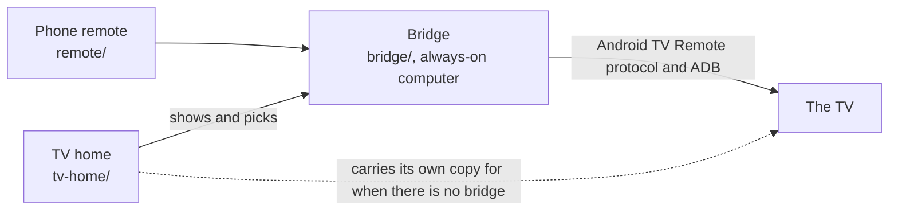

# How couch-tv works

How the TV home, the phone remote and the bridge work together, what stays private, and what couch-tv cannot do.

On this page:

- [How it fits together](#how-it-fits-together)
- [The parts](#the-parts)
- [Two TVs, one show (experimental)](#two-tvs-one-show-experimental)
- [Privacy and safety](#privacy-and-safety)
- [Limits](#limits)

## How it fits together



Samsung, LG and Roku are reached over their own network remotes instead of the Android TV Remote
protocol and ADB.

- API contract: [bridge/API.md](../bridge/API.md).
- How shows open in each streaming app: [bridge/DEEPLINKS.md](../bridge/DEEPLINKS.md).
- Watch history, taste and picks stay on your computer in `bridge/data/`. That folder is in
  `.gitignore`. You can import your own Netflix and YouTube history: [bridge/IMPORT.md](../bridge/IMPORT.md).

## The parts

| Folder | What it is | Runs on |
|---|---|---|
| `tv-home/` | The TV home: an Android TV app that becomes the TV's home screen (`android/` is the app, `web/` is its screen) | The TV (Google TV and Android TV) |
| `remote/` | The phone remote, a phone web app | Your phone |
| `bridge/` | The bridge: a small Python service that talks to the TV. Watch history, taste and picks stay in `bridge/data/` | A computer at home that stays on |
| `on-tv/` | On-TV mode (option C): the bridge inside an app on the TV, the remote with no computer | The TV |
| `samsung/` | The same TV home, packed as a Samsung app | Samsung TVs (Tizen) |
| `lg/` | The same TV home, packed as an LG app | LG TVs (webOS) |
| `roku/` | The couch-tv channel: the Night look as closely as a Roku allows | Roku |
| `tvos/` | The same home drawn again as a native SwiftUI app for tvOS 17 and newer | Apple TV |
| `vega/` | A tiny Vega app that shows the couch-tv home page in Amazon's own WebView | Fire TV on Vega OS |
| `titan/` | couch-tv's start page for a Titan app, served by the bridge at `/titan/` | Philips TVs with Titan OS |

Each TV has its own guide in [the docs index](README.md).

## Two TVs, one show (experimental)

Two Android TVs or Google TVs can be started on the same show within a few hundredths of a second of
each other, so two rooms do not echo. It needs a small helper app on each TV and a computer to run
one command. It has only been tried on two TVs, with YouTube and Netflix, and Samsung, LG, Roku and VIDAA
cannot do it. Read [docs/SYNC.md](SYNC.md) first.

## Privacy and safety

- **Privacy clean (Beta, opt in).** couch-tv replaces the ad filled home, and with `PRIVACY=1`
  `apply.sh` also switches off known tracking, ad and ACR apps it can find on your TV, reversibly
  (`pm disable-user`; `undo.sh` switches them back on). It never touches the TV's home, setup, the
  remote or Keep watching. It does not remove all tracking: see [PRIVACY.md](PRIVACY.md)
  for what it switches off by brand, what it cannot do, and the TV menu switches to turn off yourself.
  ```sh
  TV_IP=<your tv address> PRIVACY=1 DRY_RUN=1 sh tv-home/tools/apply.sh   # see what it would do
  TV_IP=<your tv address> APK=couch-tv-home.apk PRIVACY=1 sh tv-home/tools/apply.sh
  ```
- Your settings are in `config.json`, your secrets in `.env`, your data in `bridge/data/`. All
  three are ignored by git.
- Before you push a fork, run `scripts/privacy-scan.sh`. It checks for private addresses, emails,
  phone numbers, MAC addresses, home network names and secrets, in the files and the git history.
  You can also give it a file of your own words to block: `scripts/privacy-scan.sh my-denylist.txt`
  (one word per line, keep that file out of the repo). `scripts/install-hook.sh my-denylist.txt`
  runs it before every commit.
- **Never forward a port to the bridge.** The bridge listens on your home network only. Never expose
  it to the internet or forward a port to it on your router. Use a private network (VPN) if you want to
  reach it away from home.
- Option B pairing: anyone on your Wi-Fi can use the remote and the assistant unless you set a
  `pairing_key` under `bridge` in `config.json` (see [SETUP.md step 5](SETUP.md#step-5-run-the-bridge-option-b)).
- Smart home (optional, off unless you add it): the Home Assistant token goes in `.env`, then
  only into the TV app's private storage. The home page never sees it, and the app only touches the
  rooms, scenes and doorbell you list. Make a separate Home Assistant user for the TV
  ([docs/CONFIG.md](CONFIG.md), Smart home).

## Limits

- Google TV and Android TV run everything. Fire TV (Fire OS) runs all three options, with Amazon's
  home flashing up first. Samsung runs it as an app, with a computer that stays on, and LG the
  same way (run on eleven real LGs so far). Roku is built the same way and has run as a channel on one real Roku TV, but not yet with the bridge.
  Developer mode has to be on.
- A Google TV update can switch ambient mode back on. Option B's bridge checks once a day and
  switches it off again; with option A, run `apply.sh` again. couch-tv never switches the Google
  home off.
- Some apps will not open a show directly. They open the app instead. See `bridge/DEEPLINKS.md`.
- The bridge's own messages (errors, notes) are in English in every language.
- No support promise. It works on the TVs it was built on. Your TV may differ.
