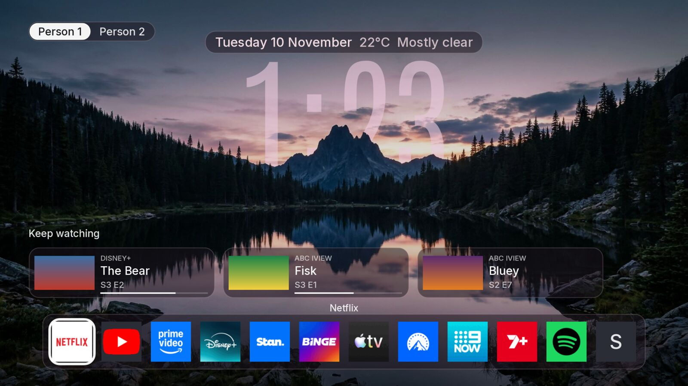
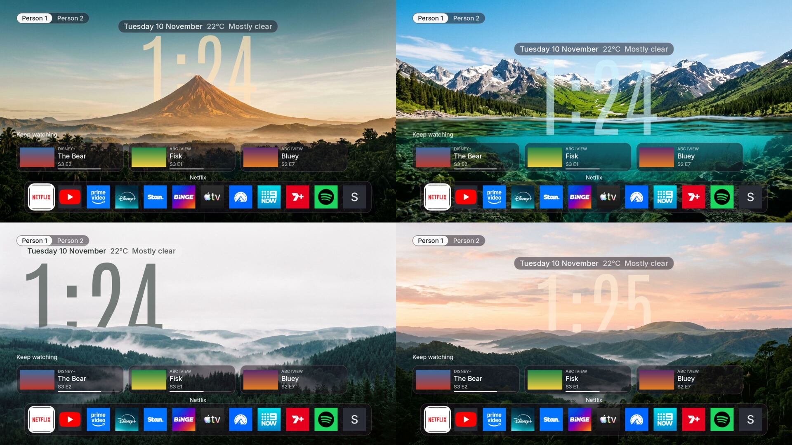

# couch-tv on a Roku

Roku does not let any app replace its home screen, and a Roku channel cannot be a web page: it is
written in BrightScript and SceneGraph and drawn by the Roku itself. So couch-tv on a Roku is **a
channel that opens itself, not a true home screen**, the same idea as on an [LG](LG.md) or a
[Samsung](SAMSUNG.md), with the home drawn again from scratch:

- **The couch-tv channel** (`roku/`): the Night look as closely as a Roku allows. The five scenes take
  turns with the clock in them (the photo's mountains, trees and hills are drawn over the digits), the
  date and weather, the people switch, Keep watching and your apps in your order. The remote's arrows
  move around and OK opens the focused app or show. It goes on the Roku as a sideloaded channel through
  Roku's Developer Mode, with no Roku account and no store.
- **The hook** (`bridge/roku.py`): the bridge (option B, a computer that stays on) watches the Roku over
  Roku's External Control Protocol (ECP). Each time the TV is switched on and nothing else is on screen,
  it opens the couch-tv channel within a few seconds.
- **The phone remote and the Claude ask** work against the Roku through the same bridge.

It needs a computer at home that stays on (option B) for the hook, the weather, the people, Keep
watching and the phone remote. Without one you can still install the channel and open it from the Roku's
home row: the clock, the date and the Roku's own apps still work, and OK opens an app through the Roku
itself.

## Test status: not yet on a real Roku

**This was built from Roku's documentation and tested against a test Roku on a computer. It has not been
run on a real Roku.** Nobody has tried it on a TV. Expect something to need fixing.

What was checked, in November 2026:

- **Against a test Roku** (`tests/roku_standin.py`, a small program that answers ECP the way Roku's
  documentation says a Roku does): power state, the power key and turning on, every remote key,
  typing, opening an app by id, by name and by a Roku id the bridge has no name for, opening a Netflix
  title and a YouTube video with the deep link, the app list and its icons, the app in front, what is
  playing, the power on hook (home, live TV, an input, an app, couch-tv already open, the hook switched
  off, a command just run, a power on from the phone) and the Control by mobile apps refusal (403) and
  how it clears.
- **The channel's code** compiles and lints with zero errors and zero warnings under BrighterScript and
  `@rokucommunity/bslint` (`cd roku && npm install && npm run check`, and a Python test runs it).
- **The channel ran in a simulator**, [brs-engine](https://github.com/lvcabral/brs-engine) (an open
  source BrightScript and SceneGraph interpreter), with a fake bridge. It drew the clock, the date and
  weather, the people switch, Keep watching and the dock; the arrows moved the focus ring and OK sent the
  right request to the bridge. This is a good check of the layout and the logic. It is **not** a Roku: it
  cannot say how fonts, 9 patch images, the fade between scenes or the speed will look or feel on a real
  one.
- **The zip** builds to about 2.4 MB (Roku's documented limit is 4 MB) and the sideload was tried against
  a test installer that asks for HTTP digest sign in as `rokudev`.

These two pictures come from that simulator, with made up shows and no real Roku or bridge behind them
(the clock reads a different time in each because they were taken a minute apart):





**Not checked on a real Roku**, and the most likely places for a surprise:

- Whether the app ids and deep links below open what they should. Only Netflix 12, YouTube 837, Hulu 2285
  and Prime Video 13 were confirmed to be ids from pages that were read, and no deep link has been tried.
- Which values `power-mode` really takes. Roku's page only shows `PowerOn`. couch-tv treats anything else
  (`Ready`, `DisplayOff` and so on) as off, so a Roku that reports its "on" with another word will look
  switched off.
- `keypress/PowerOn`. It is not in Roku's key list. Roku TVs are reported to take it, and the bridge falls
  back to Wake-on-LAN if it is refused.
- Whether `query/media-player` gives anything for the apps you use, and what `query/icon` does under each
  setting of Control by mobile apps.
- How the clock sits: the digits are placed by working out where the Antonio font's line starts, and a real
  Roku may put them a few pixels from where the simulator did.
- Whether a Roku keeps the channel across updates and power cuts, and how Roku OS 14 and 15 treat a
  sideloaded channel.

If you try it, please [open an issue](https://github.com/Seagey/couch-tv/issues) and say how it went (the TV
model, Roku OS version, what worked and what did not), even if everything worked. See "What to test first".

## What works and what does not

| | Roku |
|---|---|
| couch-tv home as a channel, apps in your order, the remote's arrows and OK | Built, not yet seen on a real Roku |
| Opens by itself when the TV is switched on | Yes, with the bridge running (not yet seen on a real Roku) |
| Roku's own Home button | Still opens Roku's home. Press the couch-tv tile on the home row, or let the phone remote's Home open it |
| Phone remote: keys, volume, mute, open an app | Yes, when "Control by mobile apps" allows it (below). Volume and power keys work on a Roku TV, not on a box |
| More than one TV on one phone remote | Yes: one bridge runs Google TVs, Samsungs, LGs and Rokus together (several entries in `config.json`) |
| "Put on Bluey" (find and play) | Netflix opens the title and YouTube opens the video (unverified, see the table below). Other apps open on their home page and the reply says to pick the show there. Nothing presses Play for you |
| "Who's watching?" in an app | You pick the profile on the TV |
| Typing into the TV from the phone | Into any box the Roku is showing a keyboard for, one character at a time |
| Turning the TV on from the phone | A Roku TV that answers on the network: yes. From fully off, only if the TV allows Wake-on-LAN (Fast TV start) |
| What is playing | The state and the position of the app in front (playing, paused), and the title when the show was started through couch-tv. ECP gives no title |
| A progress bar, screenshots, the Claude ask's "look at the screen" | No |
| Keep watching | From couch-tv's own history only (what you started through couch-tv) |
| Volume level | No: the Roku reports none, so the phone has up, down and mute only |
| Languages | English only on the Roku channel (the Android, Samsung and LG homes have six) |
| The quick buttons (sleep timer, look switch) on the home | No. The phone remote's sleep timer works |
| Picture mode switch, ADB tools, switching the stock home off | No (Android only) |

## Before you start

- The bridge running on a computer that stays on (README, option B).
- A Roku TV or a Roku box (Express, Streaming Stick, Ultra) on the same network as that computer. ECP
  works the same on both. Power and volume keys only do anything on a Roku TV.
- A **sideloaded channel is always called `dev`, and a Roku holds one.** Installing another sideloaded
  channel replaces couch-tv. Channels from the Roku Channel Store are not affected.
- Nothing to sign up for: Developer Mode needs a password you make up on the Roku, not a Roku account.

## Set it up

### 1. Developer Mode on the Roku

On the Roku remote, with the TV showing the Roku home, press

**Home three times, Up twice, Right, Left, Right, Left, Right**

The Developer Settings screen opens. Note the address it shows (the Roku's network address), choose
**Enable installer and restart**, accept the licence and make a **password** (this is the developer
password, `rokudev` is the user name). The Roku restarts. Keep the password: the install asks for it. It is
only for putting channels on this Roku, and it is not kept by couch-tv.

Roku's guide: [Set up your Roku device for development](https://developer.roku.com/docs/developer-program/getting-started/developer-setup.md).

### 2. Control by mobile apps

Newer Roku OS limits ECP, and a Roku that is limiting it refuses every key and launch with a 403 (the
bridge reads that and says so on `/api/tvs`). On the Roku open

**Settings, System, Advanced system settings, Control by mobile apps, Network access**

and choose **Permissive** (older Roku OS) or **Enabled** (newer). The names differ between Roku OS
versions and Roku's own page does not describe each choice, so if the phone remote answers "the Roku is
refusing remote control", try the other one. Default is not enough on some versions: Roku's page says some
commands (keypress, icons) need the setting on Enabled from Roku OS 14.1.

### 3. Build the channel

```sh
.venv/bin/python roku/build.py --bridge http://<bridge computer's address>:5400
```

Use the computer's number address (for example `http://192.0.2.20:5400`), not its `.local` name: a Roku may
not resolve `.local`. With more than one TV in `config.json`, add `--tv <id>` for this TV. This makes
`build/roku/couch-tv_<version>.zip`. It holds the channel, the five scene photos, the app logos and the
bridge's address. No passwords or keys go in it.

The pictures in the zip are made from the TV home's own by `roku/make-assets.py` (smaller photos, the
cutouts only where they cross the clock, logos shrunk to tile size). They are committed, so a build needs
only Python. Run `make-assets.py` yourself only to change the look (it needs ImageMagick, `dwebp` and
`pip install fonttools brotli`).

### 4. Put it on the Roku

Either let the build do it:

```sh
.venv/bin/python roku/build.py --bridge http://<bridge computer's address>:5400 --install <roku address>
```

It asks for the developer password (or reads `ROKU_DEV_PASSWORD`), signs in to the Roku's developer
installer with HTTP digest as `rokudev` and uploads the zip. It says "installed" or why not.

Or by hand: open `http://<roku address>` in a browser on the same network, sign in as `rokudev` with the
developer password, choose the zip under **Upload** and press **Install** (or **Replace**). The channel
opens on the TV straight away and appears at the end of the Roku's home row as **Couch TV**.

### 5. Tell the bridge about the TV

In `config.json`, add the TV with `"kind": "roku"`:

```json
{ "id": "lounge", "name": "Lounge", "kind": "roku", "ip": "<roku address>", "mac": "<roku mac>" }
```

`mac` is for turning the TV on from the phone when it is fully off: Settings, Network, About on the Roku
(Wi-Fi and Ethernet each have one). Leave it out if you do not want that. Give the Roku a fixed address
in your router (DHCP reservation) so it never changes. Restart the bridge.

### 6. Check it

- Switch the TV off and on with its own remote. Within a few seconds couch-tv opens.
- Arrows and OK move around and open an app. Back leaves the channel to Roku's home, and so does the
  Roku's Home button.
- On the phone remote: volume, Home (opens couch-tv), and "put on" a YouTube video or a Netflix show.
- `http://<bridge>:5400/api/tvs` shows the last few things the hook did, and `ecp.limited` (true means
  step 2 is not done).

## What to test first

In this order, because each one needs the one before:

1. Step 4: does the install say "installed", and does the channel open on the TV with the clock, the date
   and your apps? (Photos and the clock in a sensible place are the first thing to look at.)
2. `curl http://<roku address>:8060/query/device-info` and `query/apps` from the computer: does it answer
   with XML? If the phone remote later says the Roku is refusing remote control, it is step 2.
3. A key from the phone remote (an arrow, then volume), then "Home" on the phone remote (opens the channel).
4. Switch the TV off and on: does couch-tv open? If not, `/api/tvs` shows what the hook saw. Please send
   the `power-mode` value from `query/device-info` while the TV is on and while it is off.
5. Open Netflix and YouTube from the dock, then "put on" a Netflix title and a YouTube video from the phone
   (the deep links), and say what happened.
6. Say which apps in your dock got a logo and which got a letter, and which would not open.

## How the hook works

`bridge/roku.py` checks the Roku every 2 seconds over ECP (plain HTTP on port 8060): `query/device-info`
for the power state (`power-mode`), and while it is on `query/active-app` for the app in front, plus
`query/media-player` for what is playing. Every 30 minutes it reads `query/apps` (every channel, with its
id and name).

When the Roku goes from off (gone from the network, or in standby) to on, the bridge waits a moment, and if
no app is in front (Roku's home, live TV, a screensaver or an HDMI input) it launches the channel with
`launch/dev`. If the Roku came back straight into an app, it is left alone. Anything the phone remote or
Claude just asked for also wins: the hook stays quiet for 20 seconds after any command, except a power
press, so turning the TV on from the phone also lands on couch-tv. `"open_on_power_on": false` in
`config.json` turns the hook off. `"leave_inputs": true` leaves an HDMI input alone (a console or a
computer on it).

Netflix titles open with the title's id in the launch (`contentId` and a `mediaType` of `series` or
`movie`), YouTube videos with the video's id. Other apps just open.

## Control by mobile apps

ECP has no password. Roku added the setting **Control by mobile apps** to stop other things on the network
from controlling the Roku, and a Roku that is limiting it answers a keypress, a launch or an icon request
with `403 Forbidden`. The bridge keeps reading the power state either way (that read is allowed), so a
limited Roku looks switched on and does nothing when you press a key. couch-tv sees the 403, says so in the
phone remote's error and in `/api/tvs` (`ecp.limited`), and the same message appears each time a key is
tried until the setting is changed. It clears by itself on the next command that works. See step 2 for
where the setting is.

## App ids and deep links

Roku channel ids are the same on every Roku, but not every channel exists in every country. couch-tv uses
an id only when the Roku's own app list contains it, and otherwise finds an app by the name the Roku lists
it under, so a wrong id cannot open the wrong app. Apps couch-tv has no name for still show on the home
and open (they are called `roku.<id>` to the bridge).

| App | Roku id | Deep link | Status |
|---|---|---|---|
| Netflix | 12 | `contentId=<Netflix title id>&mediaType=series` or `movie` | Id confirmed ([zakwht/roku API notes](https://github.com/zakwht/roku/blob/main/docs/api.md), which also shows a `contentId` and `series` launch). **Deep link unverified on a real Roku** |
| YouTube | 837 | `contentId=<video id>&mediaType=live` | Id confirmed (same page). The deep link follows the Home Assistant Roku integration's example, found in search results, and is **unverified**; a Roku forum thread says deep link parameters are up to each channel |
| Prime Video | 13 | none | Id partly confirmed (a search snippet only). No deep link |
| Hulu | 2285 | none | Id confirmed ([Roku forum](https://forum.developer.roku.com/t/external-control-app-id-help/1975)) |
| Disney+, Max, Paramount+, Peacock, Apple TV, Plex, Spotify, Twitch, YouTube TV | in `bridge/apps.py` (`ROKU`) | none | **Ids unverified**: from channel store addresses and community lists, none confirmed from a page that was read. Used only if your Roku lists them |
| Stan, Binge, 9Now, 7plus, ABC iview, SBS On Demand, 10play, Kayo, Foxtel | not found | none | **No id found anywhere**, so found by name. Community posts say Stan and 9Now are on Australian Rokus, 7plus is mixed, and ABC iview, SBS On Demand and 10play are not in some Australian channel stores. Binge, Kayo and Foxtel were not found |

Roku's own page on deep linking ([developer.roku.com](https://developer.roku.com/docs/developer-program/discovery/implementing-deep-linking.md))
describes `launch/<id>?contentId=&mediaType=` but names no app and says each channel decides what it
does with the values. Its `mediaType` values are `movie`, `episode`, `season`, `series`, `shortFormVideo`,
`tvSpecial`, `livefeed` and `sportsevent`. To find your Roku's ids: `curl http://<roku address>:8060/query/apps`.
If an app does not open, add its id to that app's `ids` in `bridge/apps.py`.

## Limits to know

- Roku's Home button and home row are Roku's. couch-tv cannot hide Roku's ads or tiles. Leaving
  couch-tv with the Home button is expected.
- One sideloaded channel at a time, and Developer Mode has to stay on. Whether a factory reset, a software update or a
  long power cut removes it was not checked.
- Developer Mode can be used by anyone on your network who knows the developer password, so make it one
  you do not use anywhere else.
- A channel cannot read the Roku's app list itself, so the dock comes from the bridge (`/api/roku/apps`),
  or, with the bridge off, from the Roku's own ECP at `127.0.0.1:8060` (the Roku may refuse that under
  Control by mobile apps, and then the dock stays empty).
- The glass clock is a tinted number, not a picture seen through the digits: a Roku cannot cut a photo to
  the shape of text. The effect of the scenery overlapping the digits is kept.
- No screenshots, no title or progress for what is playing, no profile picking, no pressing Play inside
  other apps.
- English only, three Keep watching cards, six people at most on the switch.

## Undo

1. Remove the channel: on the Roku home row, highlight **Couch TV**, press the star (`*`) button and choose
   **Remove channel**, or open `http://<roku address>` and press **Delete**.
2. Developer Mode off: press Home three times, Up twice, Right, Left, Right, Left, Right again and choose
   **Disable installer and restart**.
3. Take the TV out of `config.json` and restart the bridge. Nothing about the Roku is kept on the computer
   (there is no key or pairing), and the developer password was never stored.
4. Put "Control by mobile apps" back if you changed it.

Nothing else on the Roku was changed.

## Sources

- ECP: [External Control API](https://developer.roku.com/docs/developer-program/dev-tools/external-control-api.md)
  (launch, keypress and its key names, `Lit_` typing, `query/device-info`, `query/icon`, `query/media-player`,
  the Control by mobile apps requirement from Roku OS 14.1).
- Deep linking: [Implementing deep linking](https://developer.roku.com/docs/developer-program/discovery/implementing-deep-linking.md).
- Developer Mode: [Developer setup](https://developer.roku.com/docs/developer-program/getting-started/developer-setup.md).
- App ids: [zakwht/roku](https://github.com/zakwht/roku/blob/main/docs/api.md),
  [Roku forum, external control app id](https://forum.developer.roku.com/t/external-control-app-id-help/1975).
- Control by mobile apps and 403:
  [Roku forum](https://forum.developer.roku.com/t/ecp-returning-403-forbidden-from-aws-requests/10853) (a
  community answer, not Roku staff).
- Australian channels: [Roku community](https://community.roku.com/discussions/tv-and-players/roku-tv-local-channel-apps-australia/906123).
- Simulator: [brs-engine](https://github.com/lvcabral/brs-engine).
