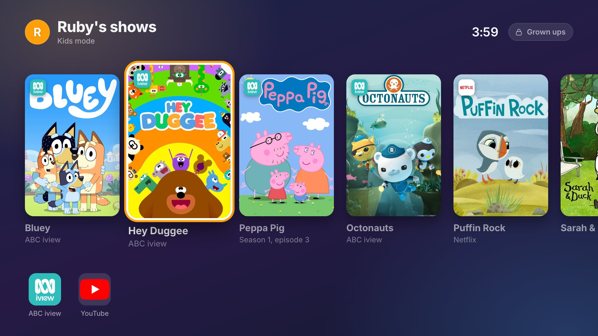
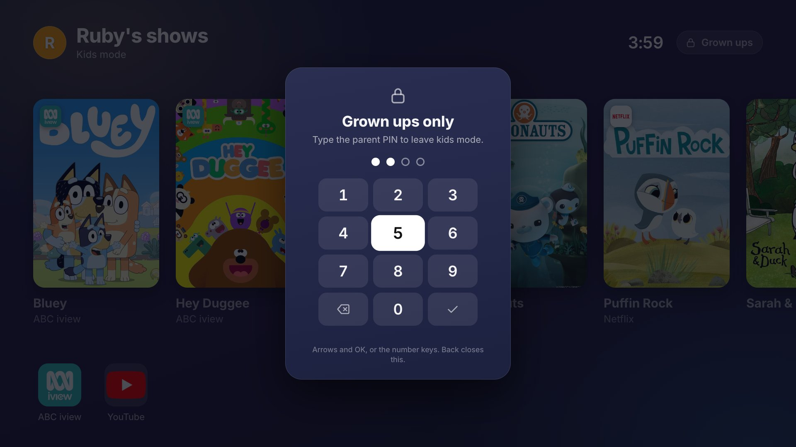
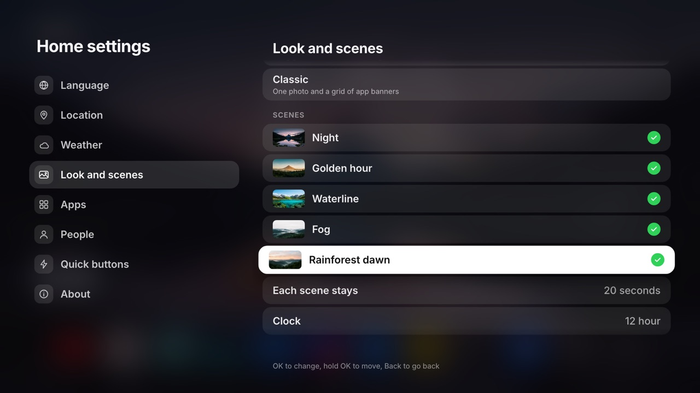

# The TV home

This page explains everything the couch-tv home screen does on the TV, and every setting you can change on the TV itself.

On this page:

- [Scenes and looks](#scenes-and-looks)
- [Finding every app](#finding-every-app)
- [Kids mode](#kids-mode)
- [Home settings](#home-settings)
- [Glass and video](#glass-and-video)
- [Your own photos](#your-own-photos)
- [Now playing](#now-playing)
- [Smart home](#smart-home)
- [Where the settings are kept](#where-the-settings-are-kept)
- [Languages](#languages)

## Scenes and looks

Five scenes take turns every 20 seconds, each with a big glass clock that sits just behind the
scenery: the peaks, the volcano and the misty hills overlap the bottom of the digits, and on the
waterline scene the clock floats on the lake with a blurred reflection under the surface. Your apps
and "keep watching" stay put.

- Start on one scene with `?scene=<name>`.
- The **Classic** look is `?theme=classic`.
- Swap in your own photos: see [Your own photos](#your-own-photos).
- **Design your own scene** (any photo, or a place you describe, with your own clock and date over
  it, and the skyline in front of the clock if you like): [MAKE-A-SCENE.md](MAKE-A-SCENE.md).

| Night | Golden hour | Waterline |
|---|---|---|
|  |  |  |
| **Fog** | **Dawn** | **Classic** (`?theme=classic`) |
|  |  |  |

Shown with sample shows and sample people. On your TV, "keep watching" fills from what you
actually watch: per TV and per person (with options B and C), up to 10 shows, newest first.
With option A it is Android's own Watch Next list, the same for everyone on that TV.

Switched on in Home settings, Look (Keep watching follows the app) or with `home.shelf_follows_app`
(off unless you ask), the row follows the remote: on an app tile it shows only what you watched in
that app, as "Recently on Netflix", and under the YouTube tile the videos you watched there (with the
bridge, option B), which the row never shows otherwise. It stays that way while you go up from the tile
into the row, and the whole row comes back on any other tile, or anywhere else on the home. An app with
nothing on the go leaves the whole row where it is.

## The Loop look

Home settings, Look, **Loop** (or `home.look` `"loop"`): the background is one short clip of a place,
looping, and the home is a caption set on it. A centred clock under the date line, bare 320 by 180
thumbnails in the Keep watching row with the title and the app under each, and a row of 112 px app
icons with no bar behind them. Nothing animates but the clip and the element gaining focus (a scale,
160 ms in and 120 ms out). The scenes, the glass clock, the drift and the ambient lighting of the Night
look are not drawn in it. The focus is a white platter with a 3 px ring outside a 2 px dark gap. The
small accent (the progress bar, the Now playing dot, a running sleep timer's minutes) follows the
weather: blue for rain, violet for a storm, grey for fog, and on a clear sky the colour of the sun's
time of day.

**What it needs.** The bridge (option B) serves the clip from its `loop/` folder, and `make-loop.sh`
makes the files from one clip of your own or a free stock clip: the same picture graded four ways
(dawn, day, dusk, night), a small blurred copy of each and two posters each. How to make them, and what
the bridge tells the home about them (`home.loop` in `config.js`), is in [LOOP.md](LOOP.md). With
**Follow the sun** on (Look, Follow the sun) the home picks the variant from the sun's height where you
are, the same way the Night scenes do, and changes at the clip's loop boundary with a plain cut, never
while the remote is moving; with it off the day grade plays all day. Without the files (no bridge, or
`make-loop.sh` not run yet) the look shows its scrim over a dark ground and still works; in a preview
(`index.html?mock=1&look=loop`) the night scene's photo stands in for the clip. A couch-tv Studio design
is not drawn in this look (it shows again in the other looks), and Home settings leaves out the Glass
panels and Mac-style dock rows here, since the look has its own. While Smart Idle's OLED Ambient Clock
or a kids mode home covers it, the clip pauses.

**The dock** is centred on the screen, as in the Night look; the Keep watching row above it stays on the
left edge. Down from a card lands on the dock tile nearest under it, and Up from the dock goes back to
the card you were on.

**The clock behind the peak.** Made from a photo with `make-loop.sh --matte` (the lake peak's own
cut-out works), the clock sits slightly behind the mountain, as in the original design: a cut-out of
what stands in front of the sky is drawn over the clock's lower part and moves with the slow push, in
step with the video. The clock and the date line sit 80 px lower then. It needs a photo (a clip's own
motion cannot be followed), the matte, and the bridge; without them the clock is in front, where it
always was. [LOOP.md](LOOP.md), the depth effect.

**What is glass, and why only there.** The two quick buttons at the top right are frosted glass: the
blurred copy of the clip plays in a second, tiny `<video>` behind them and shows only through a mask the
shape of the buttons, so the TV never blurs anything per frame (a live `backdrop-filter` over video
redraws the blur every frame, which is why Lighter home removes it elsewhere). Everything else, the
toast, the plates where a show has no picture, the Settings and More apps tiles, the people switcher,
the menus and the More apps panel, is a plain dark tint with a light rim. Measured on a Fire TV Cube
(2 GB, Fire OS 7) in the real launcher: the sharp 720p clip alone took the launcher to about 156 MB
(80 MB of it GPU textures) at 21 percent CPU with no dropped frames, about 100 MB under the home's
peak today; the blur copy masked to the two buttons added about 2 MB and 10 percent CPU; the same mask
at the size of a toast added 18 MB and made the compositor run every frame. So the glass stops at the
buttons. `home.loop.blur` false, or a blur file that will not play, leaves the buttons on the plain
tint too.

**Lighter home** in this look plays no blur copy, uses the darker tint, and sets every duration to 0,
so nothing glides; the toast keeps its fade.

While an app or the screensaver is in front, or the screen is off, both clips let go of their files and
decoders and the poster stays, so the home costs the TV about as much as a still; they load again when
the home comes back.

## Finding every app

Since 0.13. Only part of your apps fit in the dock on some TVs. Press **Down** on
the dock's bottom row to open the full apps view (the same one **More apps** opens), with the
outline on the app you were on. Back returns to the dock on that app.

## Kids mode

New, since 0.13, and optional: it is off unless you set it up, and a household
with no kids profile sees no change at all.

Make someone a kids profile and their home becomes one shelf of shows you chose, from any of the
streaming apps, as big posters. OK on a poster opens that show in its app (on the episode, if you
named one). Under the shelf sit only the apps you allow, if any. There is no More apps, no Settings
tile, no app store, no other people's Keep watching, and the phone remote's Ask is off for that
profile.



### The parent PIN

**Grown ups** at the top right (or the remote's Settings button) asks for the parent PIN, on a number
pad you work with the arrows and OK, or the number keys. Each digit shows as a dot. The right PIN
moves the TV to the first grown up's profile; to go back, pick the child's name.



### Setting it up

Add `kids_mode` to that person in `config.json` (every option), or use the phone remote (options B
and C): TV, **Kids mode**, then the PIN, then search for a show and tap the app to add it. Option C's
setup page on the TV also offers it, as an optional step.

```json
{ "id": "ruby", "name": "Ruby", "kid": true,
  "kids_mode": { "pin": "2580", "shows": ["Bluey", { "title": "Peppa Pig", "service": "abc-iview" }], "apps": ["abc-iview"] } }
```

### What it cannot do

What it cannot do, plainly: once a show is open, your child is inside Netflix (or iview, or Disney+)
and can browse anything that app offers. Pair kids mode with the app's own kids profile and limits:

- Netflix's Kids profile with its maturity rating and title blocking (Profile and Parental Controls,
  on the web)
- Disney+ Junior mode
- Prime Video's kids profile
- YouTube Kids

On some TVs the remote's Home button can still reach the TV's own home; the Home button watch brings
couch-tv back on Android TV and Google TV. The PIN keeps a child at the TV out; it is not a password
against someone with a computer on your Wi-Fi.

On an Apple TV it is in Couch TV, with the bridge, and Apple's own TV button still opens Apple's
home, so pair it with Apple's Restrictions: [APPLE-TV.md](APPLE-TV.md#kids-mode) has the steps. Not
on the Roku channel yet.

Every setting and the full list of limits: [CONFIG.md](CONFIG.md#kids-mode).

## Home settings

No computer and no `config.json` needed for the everyday settings. Press down to the dock and pick
the gear, **Settings** (just before More apps). OK opens a small menu:

- **Home settings** is couch-tv's own list.
- **TV settings** is Android's own (Wi-Fi, picture, sound).

The remote's own gear or Settings button opens the same menu
([REMOTES.md](REMOTES.md#the-gear-button)).



### Moving around

Any remote works:

- Up and down move.
- Right or OK opens a section.
- OK changes a row.
- Holding OK on a scene, an app, a person or a quick button picks it up, so up and down move it.
- Back steps back and then closes.

What you change shows when the list closes.

### Language

English, Español, Español (México), Italiano, Deutsch, Français, Türkçe, Srpski (latinica), Polski (since 0.13), Português (Brasil) (since 0.13), Čeština (since 0.13), Hebrew (עברית with full RTL layout, since 0.13), Arabic (العربية with full RTL layout, since 0.13) Romanian (Română, 24-hour clock) and Simplified Chinese (简体中文, 24-hour clock). Until one is picked here (or in
`config.json`), the home speaks the TV's own language if it is one of these, else English. More on
each language: [Languages](#languages).

### Location

Type a town or city with the TV's on-screen keyboard (or the phone remote's Type), and pick it from
the places found. It sets the weather's place and time zone.

The place search is Open-Meteo's, free and with no key. Each place shows what it belongs to (its
municipality, province or county, and region), so towns with the same name can be told apart; in
Italian the places in Italy come first, in German the places in Germany.

### Weather

- Show or hide it.
- °C or °F.
- Check every 15, 30 or 60 minutes.

Open-Meteo is the only weather provider for now. Since 0.13: **Ambient weather
effects** (light rain, snow and fog over the scenes), off to start.

### Look and scenes

- Night scenes, OLED Cinema, Classic or Loop (see [The Loop look](#the-loop-look)).
- Which scenes take turns, in what order, how many seconds each.
- A 12 or 24 hour clock. Until you pick one, an Android TV home follows the TV's own setting (System, Date and time), then the language.
- Glass panels and a video background: see [Glass and video](#glass-and-video).
- Your own photos: see [Your own photos](#your-own-photos).

Since 0.13:

- An **OLED Cinema** look (the Classic grid on pure black).
- **Follow the sun** (the scene follows dawn, day, sunset and night where you are).
- **Lighter home** for a slow box that stutters.
- **Moving tiles** (switch it off if the slowly swaying focused tile flickers on an older TV). The sway and the light that slides across the focused tile now hold still 6 s after the focus last moves, and start again with the next press.
- **Lighter home turns itself on on a low end TV** (it measures itself once a week) unless you have chosen in Home settings or with `home.lighter` ([CONFIG.md](CONFIG.md)).

Look also holds **Now playing**, **Show Keep watching** and **Sound**: see [Now playing](#now-playing).

### Apps

Every app on the TV. OK moves it between home, More apps and hidden; hold OK to change the order. The
same order as holding OK on the dock and the phone's Arrange apps.

### People

Add, rename, remove and reorder who is watching.

### Quick buttons

Choose which of these buttons show, and in what order:

- sleep timer
- picture mode
- look
- input
- Bluetooth (needs the on-TV app)
- Network (needs the on-TV app)
- screensaver

Since 0.13:

- **Soundscape** (rain, fireplace, ocean or brown noise made on the TV).
- **Screen off** (the picture goes dark while sound and the sleep timer carry on).
- **Bluetooth headphones** (opens the TV's own Bluetooth screen).

Every button and what it needs: [CONFIG.md](CONFIG.md#quick-buttons-quick), Quick buttons.

**Input** opens couch-tv's own menu where the TV lists its inputs: each HDMI port by the TV's own
name for it ("HDMI 3 (eARC)" where the TV labels it so) with what is plugged in behind it, each one
switching straight away, then Bluetooth and Network. A TV that lists no inputs gets its own input
screen, as before (#30).

**Screensaver** starts the TV's own screensaver (Google TV's Ambient mode, with the Google Photos
albums, a few seconds later; its own screen for the albums is just below, under Look). It shows only
when the TV has a screensaver switched on, and `apply.sh` switches Google TV's ambient mode off
unless you run it with `KEEP_AMBIENT=1`.

### Updates

Off until you say yes. The first time the home opens it asks once: "Tell you when a new couch-tv
version is out?" (setup can answer it for you, `home.updates`).

- **Tell me about new versions:** with it on, the TV looks on GitHub once a week, so frequent
  releases never nag; with it off nothing is checked by itself.
- **Check for updates now** looks straight away either way.
- A new release puts a small dot on the gear tile and a line on the home, naming the new version
  and the one this TV has ("couch-tv 0.13 is out (this TV has 0.12)"). Updates shows both too:
  **Version** and **Latest release**.
- **Update to ...** downloads it, checks it, and hands it to Android, which asks "Do you want to
  update this app?" first. Your settings, people, photos and apps stay.

The first time, Android asks you to let Home install apps (Settings, Security and restrictions,
Unknown sources).

Only the app from the Releases page updates this way. A copy built on your own computer, for example
with your own scenes, says so and is updated the way you installed it. It still looks for new
releases and keeps the dot and the line, so you hear when one is out.

**The on-TV app (option C)** looks the same way (asked once, then weekly, or Check for updates now),
but it cannot install an update itself: Android's installer needs a permission the phone only APK
leaves out, so Google Play Protect has nothing new to stop. Instead **Home settings, About, Update
couch-tv** shows the version line, and OK opens the exact steps: Downloader and its code 8180170 for
`couch-tv-ontv.apk` (with the full address as a fallback), or `adb install -r` from a computer for
`couch-tv-ontv-watch.apk`. Your settings stay. If Downloader says App not installed, the TV is
usually short of space: the steps say to delete the old couch-tv-ontv files in Downloader's Files and
type the code again. The launcher shows the same Update couch-tv row in About, which opens its
Updates page.

### About

The version, the GitHub address (github.com/Seagey/couch-tv), where the settings are kept, Restart
home and Reset.

**Restart home** starts the home again from scratch, the way a force-stop in the TV's Settings, Apps
and then Home would: a new WebView, the bridge looked for again, nothing taken from the old page's
cache. It keeps every setting. A change to `config.json` still needs the bridge restarted first
(option B) or `apply.sh` again (option A). With an app from before this row, or outside the TV home
app, it reloads the page.

## Glass and video

Both are optional and both are off to start.

**Glass panels.** Under Look, **Glass panels** puts clear, softly blurred panels with a light edge
behind the clock, Keep watching and the apps, so the background shows through. Blur is heavy work for
an older TV, so **On, no blur** keeps the panels and their edges without it; a TV that cannot blur at
all gets that by itself. With Glass panels on, Home settings and the menus are glass too, and focus
moves more calmly (#32, #33).

**Video background.** It plays a short clip that loops, muted, in place of the photo, in both looks.
**Video link** takes the address of an MP4 or MOV on the web or on a computer at home, and the switch
turns it off again without losing the link. The photo stays until the clip plays, and comes back if
it will not play. The video stops while an app is in front. Over a video, the Night clock is frosted
white instead of cut from the photo.

Glass panels and the video background are both heavier than the plain home, so on a small TV stick
switch them off if the home feels slow. Thanks alonmustafa (#22).

**Glass app icons** (also under Look) shows each app's symbol in light glass without its own
background, like Apple's clear icons, and a logo that is itself a shape (YouTube) keeps the shape
with its mark cut out (#25, #33).

**Focused app** chooses whether the app you are on shows its own colours or stays glass like
Apple's, shown by a lift and a brighter rim (#32).

**How clear** sets the glass from frosted to very clear in five steps (#29).

**Clock style, Liquid glass** draws the Night clock as clear glass digits that bend the photo behind
them (#25).

The phone remote follows the TV.

Links straight to Apple's own server (`sylvan.apple.com`, the tvOS aerials) never play: it uses a
certificate from Apple's private authority, which Android and Chrome do not trust. Copies of the same
aerials on other hosts, or saved on a computer at home, play fine as MOV (#27).

## Your own photos

On a TV with a file picker, **Add photos from a USB drive or this TV** opens it and copies the photos
you choose into the app (turned the right way up and sized for the screen).

Many Android TV and Google TV builds have no file picker; then the list says so and you add a photo
from a web address instead (a JPEG or PNG on the internet, which the TV loads each time). The on-TV
app (option C) only takes web addresses.

Your photos take turns with the scenes and replace the Classic look's own. The home keeps up to 20
photos (50 since 0.13).

## Your own app icons

Since 0.13. Google TV and Android TV (options A and B). A picture you make for an
app shows in place of the app's own icon on the dock and on its Keep watching badge, and in place of
its banner in the Classic grid and More apps: one style for every app, a logo the app ships too
small or soft, or a different look for an app that has none. Apps with no picture of yours keep
their own, and nothing changes until you add one.

Make a folder with an `icons` folder (square, about 512 x 512) and a `banners` folder (16:9, about
640 x 360) in it, and name each picture after the app's package: `icons/com.netflix.ninja.png`,
`banners/com.netflix.ninja.png`. PNG, JPEG (`.jpg`) or WebP. `survey-tv.py` lists every app's
package name. Then, from the repo root:

```sh
TV_IP=<your tv address> sh tv-home/tools/app-icons.sh my-icons        # copy them, adds or replaces
TV_IP=<your tv address> sh tv-home/tools/app-icons.sh --list          # what is on the TV now
TV_IP=<your tv address> sh tv-home/tools/app-icons.sh --remove        # every app's own pictures again
```

They go in the home's own folder on the TV (`Android/data/app.couchtv.launcher/files/custom`), and
the home loads them straight away (the same as Home settings, About, Restart home). Taking the home
off the TV takes them with it.

- **Glass app icons** draws your picture in glass like the rest. Switch it off (Look) to see your
  pictures as they are.
- The phone remote's app grid keeps the apps' own icons.
- The on-TV app (option C), LG, Samsung, Roku and the rest keep the apps' own icons.

## Now playing

When Spotify or any other music app is playing behind the home, a card shows the song, the artist
and its cover, with previous, play or pause and next (the remote's own media keys). In the Night
look it is the first card of the Keep watching row; in Classic it sits under the quick buttons. A
paused song stays for ten minutes.

General media support uses option B or C. On Android TV with option A, `home.spotify_player` and
Android's Notification access can show and control Spotify's active TV session. Home settings,
Look, Now playing switches the card off. The bridge gets covers from Apple's free music search.
Thanks alonmustafa (#31).

Since 0.13: a full screen Now playing view with the album art, off to start (#84).

**Show Keep watching** (Home settings, Look, or `home.keep_watching`, since 0.13):
switch it off to hide the whole row and stop fetching it.

**Start on** (Home settings, Look, or `home.start_focus`, since 0.13): where the
remote starts when you press Home. Profiles is as before, Keep watching starts on the first show
card, and Apps starts on the first app (thanks nidhalmouldi, #211, and ekagra-codes, #212).

**Navigation sound** (Home settings, Look, Sound): the TV's own click, a soft tap, or none (#32).

## Custom cards

Since 0.13. Your own cards on the home, without changing couch-tv: the solar
panels' output today, bin night, the surf, a family message. couch-tv reads a small JSON file and
shows what is in it at the end of the Keep watching row. It only shows them: it never runs anything
from the file, so whatever writes the file is up to you (a script on a Raspberry Pi, a GitHub
Action, a file you edit by hand). The idea came from geissmannz on Instagram.

It is off unless `home.custom_cards` in `config.json` names the file. That can be either:

- **A file on the bridge computer** (option B), for example `"custom_cards": "cards.json"`. A path
  that is not absolute is read from the folder `config.json` is in. The TV never sees the path.
- **An http or https link**, for example a raw GitHub file or a Raspberry Pi on your Wi-Fi
  (`"custom_cards": "http://raspberrypi:8080/cards.json"`). With a bridge, the bridge reads it, so the
  server needs nothing special. The on-TV app (option C) has no bridge, so the TV reads the link
  itself, and then the server has to allow it (send `Access-Control-Allow-Origin: *`; GitHub's raw
  files already do).

Why the bridge reads it: one place cleans the file (`bridge/custom_cards.py`), a Raspberry Pi on
the network needs no web settings, and a bad file never slows the home. The TV home cleans it again
(`tv-home/web/cards.js`), because on the on-TV app it reads the link itself.

The file (a bare list of cards works too):

```json
{
  "cards": [
    {"title": "Solar today", "value": "18.4 kWh", "subtitle": "Roof panels",
     "image": "https://example.com/sun.png", "app": "com.example.solar"},
    {"title": "Bin night", "value": "Recycling", "subtitle": "Put out by 7 pm",
     "url": "https://example.com/bins"}
  ]
}
```

| Field | What it is |
|---|---|
| `title` | Needed. Up to 40 characters. A card without one is left out. |
| `value` | Optional, the big line: a number, a word. Up to 24 characters. |
| `subtitle` | Optional, the small line. Up to 60 characters. |
| `image` | Optional. An `http` or `https` link to a picture. Anything else is ignored. |
| `app` | Optional. What OK opens: an installed app, by its Android package name (for example `com.netflix.ninja`). It goes through the same check and launch as the app tiles. |
| `url` | Optional, used only when there is no `app`. An `http` or `https` link that OK opens on the TV. |

The limits are hard: at most 8 cards (the rest are left out), each piece of text cut to its length,
and a file over 64 KB is refused. Every piece of text shows exactly as written: `<b>` stays `<b>`,
nothing is read as HTML or code. `javascript:` and every other kind of link is refused, and so is a
link with spaces, quotes, `$` or a backtick in it. A card with no `app` or `url` simply does nothing
on OK.

The home asks for the cards when it opens and every 10 minutes after that, and the bridge reads the
file at most once a minute. If the file is missing, is not JSON, or the link does not answer, the home
keeps the last good cards (none, if it never had any) and carries on.

They look like the shows: glass cards on the Night look, tiles on Classic, and the remote moves to them
like any other card in the row. With Keep watching switched off, or with nothing to keep watching, the
row stays for your cards and its heading says "Your cards". There is no switch in Home settings: take
`home.custom_cards` out of `config.json` to hide them. It works wherever the home is this web page
(Android and Google TV, LG, Samsung, the on-TV app); the Roku and Apple TV homes do not show them yet.

## Smart home

Optional. If you already run Home Assistant, the home can show:

- your air conditioning (each room's temperature, warmer, cooler, on, off and mode)
- your scenes and scripts as tiles
- a doorbell card with the door camera's picture over whatever is playing

It is off unless you add a `home_assistant` section to `config.json`; without it nothing changes.
[CONFIG.md](CONFIG.md#smart-home-optional-through-home-assistant), Smart home, has the setup.

## Where the settings are kept

On the TV, and with option B on the computer too, so the phone agrees and a reset TV gets them back.
They win over `config.json` on that TV; About, Reset home settings goes back to it.
[CONFIG.md](CONFIG.md#settings-made-on-the-tv-home-settings) has the details.

## Languages

| Language | Code | Clock by default | TV home | Phone remote |
|---|---|---|---|---|
| English | `en` | 12 hour | Yes | Yes |
| Spanish, for Spain and everyone else | `es` | 12 hour | Yes | Yes |
| Mexican Spanish | `es-MX` | 12 hour | Yes | Yes |
| Italian | `it` | 24 hour | Yes | Yes |
| German | `de` | 24 hour | Yes | Yes |
| Turkish | `tr` | 24 hour | Yes | Yes |
| Serbian Latin | `sr-Latn-RS` | 24 hour | Yes | Yes |
| Polish | `pl` | 24 hour | Yes, since 0.13 | Yes, since 0.13 |
| Dutch | `nl` | 24 hour | Yes, since 0.13 | Not yet |
| Hebrew, with full right-to-left layout | `he` | 24 hour | Yes | Not yet |
| French | `fr` | 24 hour | Yes | Not yet |
| Czech | `cs` | 24 hour | Yes, since 0.13 | Yes, since 0.13 |
| Brazilian Portuguese | `pt` | 24 hour | Yes, since 0.13 | Yes, since 0.13 |
| Arabic, with full right-to-left layout | `ar` | 12 hour | Yes, since 0.13 | Not yet |
| Romanian | `ro` | 24 hour | Yes | Not yet |
| Simplified Chinese | `zh-CN` | 24 hour | Yes | Yes |

The TV home and the phone remote both speak English, Spanish (`es`, for Spain and everyone else),
Mexican Spanish (`es-MX`: computadora, celular, presionar, clima and the rest), Italian (`it`),
German (`de`), Turkish (`tr`), Serbian Latin (`sr-Latn-RS`), Czech (`cs`, 24 hour clock, since 0.13), Polish (`pl`, since 0.13), Brazilian Portuguese (`pt`, since 0.13), Dutch (`nl`, TV home only for now, since 0.13) and Hebrew (`he`, with full right-to-left layout and 24 hour clock, TV
home only for now), Arabic (`ar`, with full right-to-left layout, TV home only for now, since 0.13) and Romanian (`ro`, TV home only for now), and Simplified Chinese (`zh-CN`, 24 hour clock). The TV home also speaks French (`fr`, 24 hour clock); the phone
remote has no French yet. Italian, German, Turkish, Serbian, Czech, Polish, Brazilian Portuguese, Dutch, Hebrew, Romanian and Simplified Chinese use a 24 hour clock by
default unless you pick 12 hour.

The optional smart-home controls are translated too. The phone has its own choice (TV menu,
Language), "Same as the TV" by default. Messages that come from the bridge itself (an error, a note
about how a show opened) and some screen reader labels on the phone are still in English.
