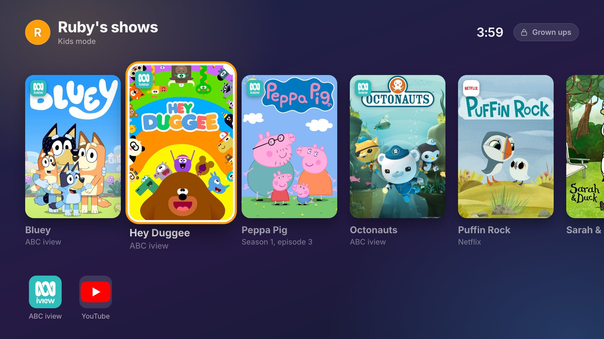
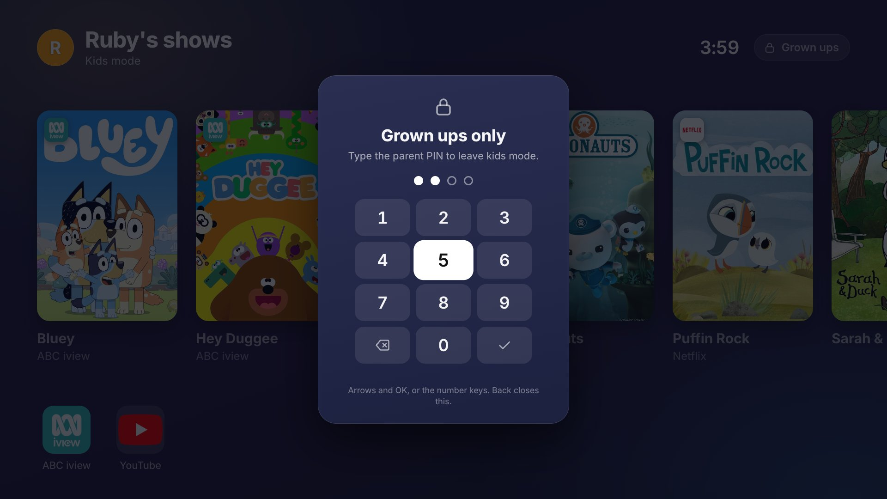
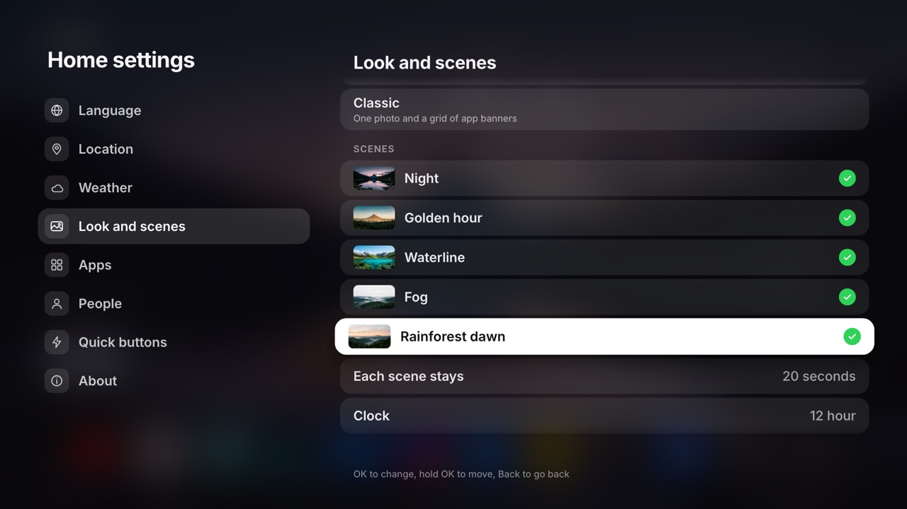

# The TV home

This page explains everything the couch-tv home screen does on the TV, and every setting you can change on the TV itself.

On this page:

- [Scenes and looks](#scenes-and-looks)
- [Finding every app](#finding-every-app)
- [Kids mode](#kids-mode)
- [Home settings](#home-settings)
- [Glass and video](#glass-and-video)
- [Your own photos](#your-own-photos)
- [Now playing](#now-playing)
- [Smart home](#smart-home)
- [Where the settings are kept](#where-the-settings-are-kept)
- [Languages](#languages)

## Scenes and looks

Five scenes take turns every 20 seconds, each with a big glass clock that sits just behind the
scenery: the peaks, the volcano and the misty hills overlap the bottom of the digits, and on the
waterline scene the clock floats on the lake with a blurred reflection under the surface. Your apps
and "keep watching" stay put.

- Start on one scene with `?scene=<name>`.
- The **Classic** look is `?theme=classic`.
- Swap in your own photos: see [Your own photos](#your-own-photos).
- **Design your own scene** (any photo, or a place you describe, with your own clock and date over
  it, and the skyline in front of the clock if you like): [MAKE-A-SCENE.md](MAKE-A-SCENE.md).

| Night | Golden hour | Waterline |
|---|---|---|
|  |  |  |
| **Fog** | **Dawn** | **Classic** (`?theme=classic`) |
|  |  |  |

Shown with sample shows and sample people. On your TV, "keep watching" fills from what you
actually watch: per TV and per person (with options B and C), up to 10 shows, newest first.
With option A it is Android's own Watch Next list, the same for everyone on that TV.

## Finding every app

On main, in the next release. Only part of your apps fit in the dock on some TVs. Press **Down** on
the dock's bottom row to open the full apps view (the same one **More apps** opens), with the
outline on the app you were on. Back returns to the dock on that app.

## Kids mode

New, on main, in the next release, and optional: it is off unless you set it up, and a household
with no kids profile sees no change at all.

Make someone a kids profile and their home becomes one shelf of shows you chose, from any of the
streaming apps, as big posters. OK on a poster opens that show in its app (on the episode, if you
named one). Under the shelf sit only the apps you allow, if any. There is no More apps, no Settings
tile, no app store, no other people's Keep watching, and the phone remote's Ask is off for that
profile.



### The parent PIN

**Grown ups** at the top right (or the remote's Settings button) asks for the parent PIN, on a number
pad you work with the arrows and OK, or the number keys. Each digit shows as a dot. The right PIN
moves the TV to the first grown up's profile; to go back, pick the child's name.



### Setting it up

Add `kids_mode` to that person in `config.json` (every option), or use the phone remote (options B
and C): TV, **Kids mode**, then the PIN, then search for a show and tap the app to add it. Option C's
setup page on the TV also offers it, as an optional step.

```json
{ "id": "ruby", "name": "Ruby", "kid": true,
  "kids_mode": { "pin": "2580", "shows": ["Bluey", { "title": "Peppa Pig", "service": "abc-iview" }], "apps": ["abc-iview"] } }
```

### What it cannot do

What it cannot do, plainly: once a show is open, your child is inside Netflix (or iview, or Disney+)
and can browse anything that app offers. Pair kids mode with the app's own kids profile and limits:

- Netflix's Kids profile with its maturity rating and title blocking (Profile and Parental Controls,
  on the web)
- Disney+ Junior mode
- Prime Video's kids profile
- YouTube Kids

On some TVs the remote's Home button can still reach the TV's own home; the Home button watch brings
couch-tv back on Android TV and Google TV. The PIN keeps a child at the TV out; it is not a password
against someone with a computer on your Wi-Fi.

On an Apple TV it is in Couch TV, with the bridge, and Apple's own TV button still opens Apple's
home, so pair it with Apple's Restrictions: [APPLE-TV.md](APPLE-TV.md#kids-mode) has the steps. Not
on the Roku channel yet.

Every setting and the full list of limits: [CONFIG.md](CONFIG.md#kids-mode).

## Home settings

No computer and no `config.json` needed for the everyday settings. Press down to the dock and pick
the gear, **Settings** (just before More apps). OK opens a small menu:

- **Home settings** is couch-tv's own list.
- **TV settings** is Android's own (Wi-Fi, picture, sound).

The remote's own gear or Settings button opens the same menu
([REMOTES.md](REMOTES.md#the-gear-button)).



### Moving around

Any remote works:

- Up and down move.
- Right or OK opens a section.
- OK changes a row.
- Holding OK on a scene, an app, a person or a quick button picks it up, so up and down move it.
- Back steps back and then closes.

What you change shows when the list closes.

### Language

English, Español, Español (México), Italiano, Deutsch, Français, Türkçe, Srpski (latinica) and
Hebrew (עברית with full RTL layout, on main, in the next release). Until one is picked here (or in
`config.json`), the home speaks the TV's own language if it is one of these, else English. More on
each language: [Languages](#languages).

### Location

Type a town or city with the TV's on-screen keyboard (or the phone remote's Type), and pick it from
the places found. It sets the weather's place and time zone.

The place search is Open-Meteo's, free and with no key. Each place shows what it belongs to (its
municipality, province or county, and region), so towns with the same name can be told apart; in
Italian the places in Italy come first, in German the places in Germany.

### Weather

- Show or hide it.
- °C or °F.
- Check every 15, 30 or 60 minutes.

Open-Meteo is the only weather provider for now. On main, in the next release: **Ambient weather
effects** (light rain, snow and fog over the scenes), off to start.

### Look and scenes

- Night scenes or Classic.
- Which scenes take turns, in what order, how many seconds each.
- A 12 or 24 hour clock.
- Glass panels and a video background: see [Glass and video](#glass-and-video).
- Your own photos: see [Your own photos](#your-own-photos).

On main, in the next release:

- An **OLED Cinema** look (the Classic grid on pure black).
- **Follow the sun** (the scene follows dawn, day, sunset and night where you are).
- **Lighter home** for a slow box that stutters.
- **Moving tiles** (switch it off if the slowly swaying focused tile flickers on an older TV).

Look also holds **Now playing**, **Show Keep watching** and **Sound**: see [Now playing](#now-playing).

### Apps

Every app on the TV. OK moves it between home, More apps and hidden; hold OK to change the order. The
same order as holding OK on the dock and the phone's Arrange apps.

### People

Add, rename, remove and reorder who is watching.

### Quick buttons

Choose which of these buttons show, and in what order:

- sleep timer
- picture mode
- look
- input
- Bluetooth (needs the on-TV app)
- Network (needs the on-TV app)
- screensaver

On main, in the next release:

- **Soundscape** (rain, fireplace, ocean or brown noise made on the TV).
- **Screen off** (the picture goes dark while sound and the sleep timer carry on).
- **Bluetooth headphones** (opens the TV's own Bluetooth screen).

Every button and what it needs: [CONFIG.md](CONFIG.md#quick-buttons-quick), Quick buttons.

**Input** opens couch-tv's own menu where the TV lists its inputs: each HDMI port by the TV's own
name for it ("HDMI 3 (eARC)" where the TV labels it so) with what is plugged in behind it, each one
switching straight away, then Bluetooth and Network. A TV that lists no inputs gets its own input
screen, as before (#30).

**Screensaver** starts the TV's own screensaver (Google TV's Ambient mode, with the Google Photos
albums, a few seconds later; its own screen for the albums is just below, under Look). It shows only
when the TV has a screensaver switched on, and `apply.sh` switches Google TV's ambient mode off
unless you run it with `KEEP_AMBIENT=1`.

### Updates

Off until you say yes. The first time the home opens it asks once: "Tell you when a new couch-tv
version is out?" (setup can answer it for you, `home.updates`).

- **Tell me about new versions:** with it on, the TV looks on GitHub once a week, so frequent
  releases never nag; with it off nothing is checked by itself.
- **Check for updates now** looks straight away either way.
- A new release puts a small dot on the gear tile and a line on the home.
- **Update to ...** downloads it, checks it, and hands it to Android, which asks "Do you want to
  update this app?" first. Your settings, people, photos and apps stay.

The first time, Android asks you to let Home install apps (Settings, Security and restrictions,
Unknown sources).

Only the app from the Releases page updates this way. A copy built on your own computer, for example
with your own scenes, says so and is updated the way you installed it. The on-TV app (option C) does
not do this yet.

### About

The version, the GitHub address (github.com/Seagey/couch-tv), where the settings are kept, and
Reset.

## Glass and video

Both are optional and both are off to start.

**Glass panels.** Under Look, **Glass panels** puts clear, softly blurred panels with a light edge
behind the clock, Keep watching and the apps, so the background shows through. Blur is heavy work for
an older TV, so **On, no blur** keeps the panels and their edges without it; a TV that cannot blur at
all gets that by itself. With Glass panels on, Home settings and the menus are glass too, and focus
moves more calmly (#32, #33).

**Video background.** It plays a short clip that loops, muted, in place of the photo, in both looks.
**Video link** takes the address of an MP4 or MOV on the web or on a computer at home, and the switch
turns it off again without losing the link. The photo stays until the clip plays, and comes back if
it will not play. The video stops while an app is in front. Over a video, the Night clock is frosted
white instead of cut from the photo.

Glass panels and the video background are both heavier than the plain home, so on a small TV stick
switch them off if the home feels slow. Thanks alonmustafa (#22).

**Glass app icons** (also under Look) shows each app's symbol in light glass without its own
background, like Apple's clear icons, and a logo that is itself a shape (YouTube) keeps the shape
with its mark cut out (#25, #33).

**Focused app** chooses whether the app you are on shows its own colours or stays glass like
Apple's, shown by a lift and a brighter rim (#32).

**How clear** sets the glass from frosted to very clear in five steps (#29).

**Clock style, Liquid glass** draws the Night clock as clear glass digits that bend the photo behind
them (#25).

The phone remote follows the TV.

Links straight to Apple's own server (`sylvan.apple.com`, the tvOS aerials) never play: it uses a
certificate from Apple's private authority, which Android and Chrome do not trust. Copies of the same
aerials on other hosts, or saved on a computer at home, play fine as MOV (#27).

## Your own photos

On a TV with a file picker, **Add photos from a USB drive or this TV** opens it and copies the photos
you choose into the app (turned the right way up and sized for the screen).

Many Android TV and Google TV builds have no file picker; then the list says so and you add a photo
from a web address instead (a JPEG or PNG on the internet, which the TV loads each time). The on-TV
app (option C) only takes web addresses.

Your photos take turns with the scenes and replace the Classic look's own. The home keeps up to 20
photos (50 on main, in the next release).

## Now playing

When Spotify or any other music app is playing behind the home, a card shows the song, the artist
and its cover, with previous, play or pause and next (the remote's own media keys). In the Night
look it is the first card of the Keep watching row; in Classic it sits under the quick buttons. A
paused song stays for ten minutes.

It needs option B or C: Android does not let an ordinary app see what other apps play, so option A
has no card. Home settings, Look, Now playing switches it off. The cover comes from Apple's free
music search. Thanks alonmustafa (#31).

On main, in the next release: a full screen Now playing view with the album art, off to start (#84).

**Show Keep watching** (Home settings, Look, or `home.keep_watching`, on main, in the next release):
switch it off to hide the whole row and stop fetching it.

**Navigation sound** (Home settings, Look, Sound): the TV's own click, a soft tap, or none (#32).

## Smart home

Optional. If you already run Home Assistant, the home can show:

- your air conditioning (each room's temperature, warmer, cooler, on, off and mode)
- your scenes and scripts as tiles
- a doorbell card with the door camera's picture over whatever is playing

It is off unless you add a `home_assistant` section to `config.json`; without it nothing changes.
[CONFIG.md](CONFIG.md#smart-home-optional-through-home-assistant), Smart home, has the setup.

## Where the settings are kept

On the TV, and with option B on the computer too, so the phone agrees and a reset TV gets them back.
They win over `config.json` on that TV; About, Reset home settings goes back to it.
[CONFIG.md](CONFIG.md#settings-made-on-the-tv-home-settings) has the details.

## Languages

| Language | Code | Clock by default | TV home | Phone remote |
|---|---|---|---|---|
| English | `en` | 12 hour | Yes | Yes |
| Spanish, for Spain and everyone else | `es` | 12 hour | Yes | Yes |
| Mexican Spanish | `es-MX` | 12 hour | Yes | Yes |
| Italian | `it` | 24 hour | Yes | Yes |
| German | `de` | 24 hour | Yes | Yes |
| Turkish | `tr` | 24 hour | Yes | Yes |
| Serbian Latin | `sr-Latn-RS` | 24 hour | Yes | Yes |
| Dutch | `nl` | 24 hour | Yes, on main, in the next release | Not yet |
| Hebrew, with full right-to-left layout | `he` | 24 hour | Yes | Not yet |
| French | `fr` | 24 hour | Yes | Not yet |

The TV home and the phone remote both speak English, Spanish (`es`, for Spain and everyone else),
Mexican Spanish (`es-MX`: computadora, celular, presionar, clima and the rest), Italian (`it`),
German (`de`), Turkish (`tr`), Serbian Latin (`sr-Latn-RS`), Dutch (`nl`, TV home only for now, on
main, in the next release) and Hebrew (`he`, with full right-to-left layout and 24 hour clock, TV
home only for now). Italian, German, Turkish, Serbian, Dutch and Hebrew use a 24 hour clock by
default unless you pick 12 hour. The TV home also speaks French (`fr`, 24 hour clock); the phone
remote has no French yet.

The optional smart-home controls are translated too. The phone has its own choice (TV menu,
Language), "Same as the TV" by default. Messages that come from the bridge itself (an error, a note
about how a show opened) and some screen reader labels on the phone are still in English.
